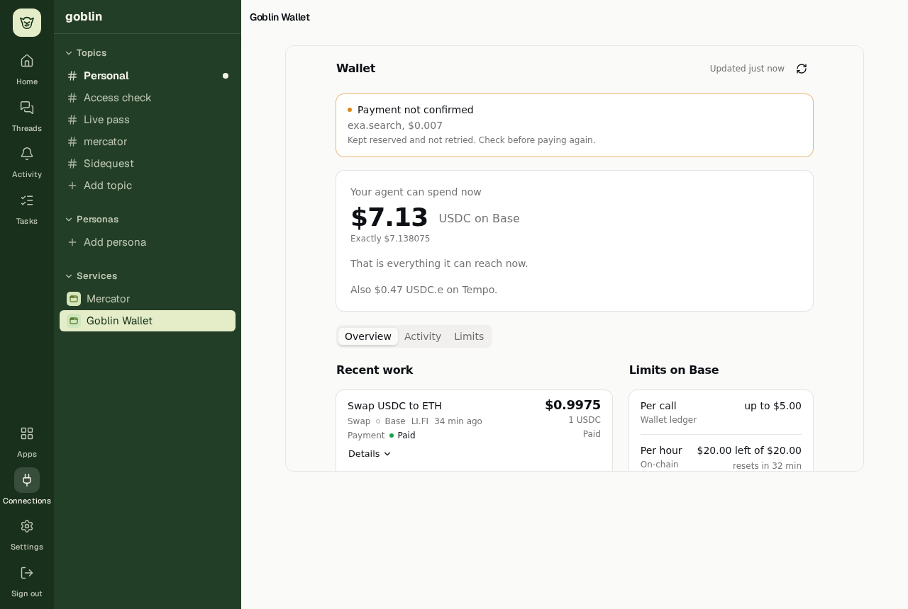
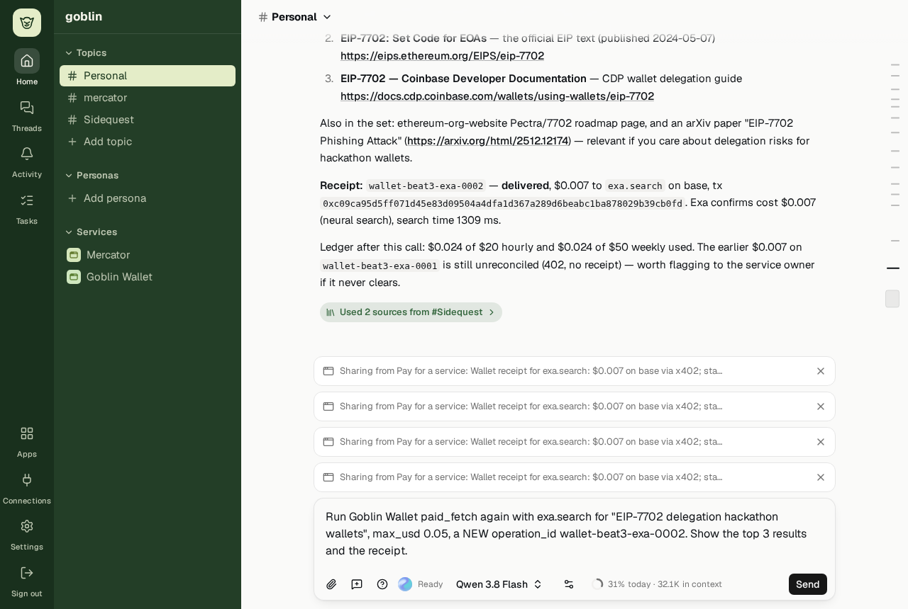
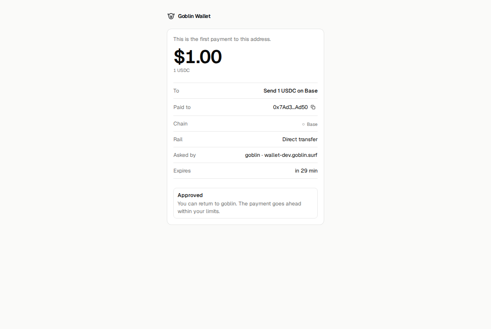

# goblin

Your own goblin, always on. Resident personal agents on Cloudflare. Each user signs up, subscribes to Pro ($10/month), and gets their own agent: they talk to it in the browser,
it keeps running, holds its own authority to use the MCP servers that user connected, and is itself an MCP server
other tools can talk to.

The agent has one stable main chat (`/c/1`); it resolves to the current Pi session. Side threads can start empty or branch from any message of any conversation, at
any depth; they can share a note back to where they came from, and Close stops one with everything under it until it is
reopened. Main learns the name of a thread started empty, and one live feed keeps every open tab's list and activity
current. The web app is a Slack-style shell: a moss rail and a sidebar of Topics as channels, the channel (Personal's
is Main), and a thread panel beside it where a message's thread opens, stacking threads opened inside threads. Each Topic has a setup:
the MCP servers and their tools, skills, agent apps and subagents its chats work with, everything until the owner
chooses a list, and a Persona adds its own while it answers there. Background subagents work in their own conversations, start their own when a job splits, post their final
answer in the conversation that started them (attributed, and not answered again unless the job asked for synthesis) and close
when done; the owner can write to one to steer it. Personas are named, versioned agents the owner tags with `@name`: each tagged Persona
answers once, attributed, in the same chat, and Goblin can organize Topics and Personas on request, leaving receipts the owner can undo. Every Topic's Conversation (Main is Personal's) keeps its own OptChat-style memory view: summaries of older messages followed by the
newest exchange verbatim.

Tool calls expand in place to readable input and output, with folding JSON branches, formatted Markdown, full-value
copying and a Raw view.
The agent's replies draw Mermaid diagrams, charts and maps from fenced blocks, in the theme's colours.
Diagrams offer an explorer with zoom, pan and node connections, shared with agent apps.

Telegram comes through a mygram MCP connection. The owner turns on a server's **Telegram** switch in Connections; signed
MCP Events wake an authoritative inbox pull into main, and replies go back with `send_message`. Older servers use
the doorbell fallback until cut-over. Owner-enabled skills libraries use update Events to invalidate their cached
catalog; the next activation refetches, while retained activations keep their verified version.

Apps run in place in any conversation, several at once, and move to their page (`/a/<id>`, with the way back to its
channel) and back without reloading. On a phone the navigation is a drawer and a thread is a full view with a back to
its channel. Owners can add public servers by URL or from MCP registries,
grant tools explicitly, mark individual tools **Ask first** for approval of every exact call, choose an offered model, and see the per-account daily budget in Credits. The agent uses `ask_user`
to ask questions the owner answers in their next message. The owner attaches files to a message with the composer's
paperclip; the agent reads them and writes its own results beside them, kept per agent in SQLite and R2.

Messages sent while Main or an ordinary thread works stay visible in a queue above its composer, oldest first,
with their author, files and references. Sending adds a follow-up; it does not interrupt the current turn. The queue
is separate from the transcript until Pi starts that input, and survives refreshes and reconnects.
Each queued message can be removed while it is waiting; a message Pi has already started keeps running.

In the composer, `/` selects skills or `/help`, `/new-thread` and `/stop`; `@` selects connected servers, skills or
helpers. Selections become removable chips. A skill can be sent alone; a helper reference brings its latest report
into the current conversation. Helpers share live execution capabilities and can be narrowed by their parent.

The agent builds apps for its owner from ordinary conversation (ADR 0021): small programs goblin runs in Cloudflare
Dynamic Workers, with durable state, actions and views that become the agent's tools, an optional live UI drawn with
goblin's components, charts, maps and diagrams, schedules that run on their own, and powers (the web,
the owner's MCP tools, a cheap model, Telegram, other apps) that each wait for the owner's Allow. The Apps page lists them; an app can
fill the workspace with its conversation docked beside it, roll back to an earlier version, or be deleted.

Every turn can be seen end to end (ADR 0024). Beside Pi's own record, each agent keeps a 30-day run ledger of how its
turns ran: model attempts, tool calls, retries, MCP steps, Telegram replies, timings, tokens and errors, never content.
Workers Logs and Traces carry the same ids. A coding agent reads the owner's conversations and any turn's timeline
through the read-only inspection tools of goblin's one MCP endpoint, `/mcp` (when the owner grants `goblin:inspect`), or
the `goblin` CLI (`apps/cli`), and the agent answers "why did that fail?" with its own `diagnose` tool.
Diagnostics focus on work needing attention; `problems --all` includes expected waits and recovered model attempts.
Successful background model completions stay out of problems; their failures remain visible.
Private error details stay in conversation inspection; logs and traces carry fixed summaries.
The ledger also records how conversations move, content-free (ADR 0037): sends, threads, moves, share-backs, closes
and Stops, Personas, Delegates, Topics, organize Undo, routines, Telegram deliveries and decision proposals. A message's
Details shows what ran behind it, every failure the app shows quotes a reference (`… · ref 7f3a9c12`) that
`goblin lookup` finds in the Worker's logs, and `goblin stats` sums flows across every agent of a stage from Workers
Analytics Engine, under hashed agent ids.

Typed decisions judge ordinary Delegate reports and the owner's exchanges with rules, then Cloudflare Clef for
undecided cases. They propose a highlight, a thread draft, or earlier work from the owner's other chats for the owner
to confirm or dismiss, keep that label, and leave chat working when decisions are unavailable. They never move
history, route a send or grant permission. Each open proposal shows in its chat as an "Only visible to you" row. Only
the dev stage binds Workers AI; elsewhere nothing is judged. See
[ADR 0031](docs/adr/0031-typed-decisions-through-workers-ai.md).

**Goblin Wallet** (ADR 0045) gives the agent money with limits its owner sets. It is a separate Worker with its own MCP
server at `wallet.goblin.surf` (`wallet-dev.goblin.surf` for dev), built from `apps/wallet`, `apps/wallet-web` and
`packages/wallet`, and those three are MIT-licensed. The owner signs in with Privy, funds their own address with USDC
(Relay deposit addresses convert ETH or USDC from Base, Arbitrum or Ethereum), and upgrades the account with EIP-7702 to
MetaMask's DeleGator. The owner then signs an ERC-7710 period allowance to an agent wallet that Privy holds under a
signer policy. Every EVM send, the owner's upgrade included, is an ERC-4337 UserOperation bundled by Pimlico, its gas
paid in USDC by the ERC-20 paymaster, so no account ever needs ETH (ADR 0050). The agent pays x402 services on Base and MPP services on Tempo, sends USDC, swaps
through LI.FI and bridges through Relay, topping up just in time from the allowance. Paid inference and MPP services pay
from the agent's own address on Tempo; the wallet App shows that address with a QR code and adds funds to it from any
chain.

Every limit names the layer that enforces it: the on-chain allowance, Privy's policy, the wallet's ledger (per call,
hour and week) or goblin's spending rules (ADR 0044). A spend over the limit, or to a new recipient, becomes a URL
request to the wallet's Approve page, where the owner checks the frozen terms; goblin then retries the call with the
same operation id, which never pays twice. goblin connects the wallet like any MCP server, shows its status on the
connection card and its dashboard App under Pinned. It also tops up Mercator's own balance from the wallet before a
job Mercator is short for, within a rule the owner sets ($5 a top-up and $20 a day by default, ADR 0049). Try it at goblin.surf → Connections → Goblin Wallet.

Proven on mainnet on 12 October 2026, from goblin dev:

- goblin paid Exa $0.007 for a web search over x402, after topping up from the allowance:
  [`0xc09ca95d…b0fd`](https://basescan.org/tx/0xc09ca95d5ff071d45e83d09504a4dfa1d367a289d6beabc1ba878029b39cb0fd).
- A first payment to a new address waited for the owner's approval, then went out:
  [`0xe4219e53…e3dc`](https://basescan.org/tx/0xe4219e53ec87f363181090b28a2e008f0bc02221dc689fb75068cb8dbab8e3dc).
- Mercator ran short, so the wallet bridged 2 USDC from Base to Tempo through Relay
  ([`0x2dce0489…3e7b`](https://basescan.org/tx/0x2dce04899f917d6c3e7aab58ba25ff663fe176d9ab34484b130622a6712f3e7b))
  and paid Mercator 1.5 USDC.e
  ([`0xf144e54d…2add`](https://explore.tempo.xyz/tx/0xf144e54d48fd28c1208acbb647275dbbf7fc5f335794d2e37ef79d08fcde2add)).





Limits today: Privy runs in development mode with email sign-in, and the mainnet funds behind the demo are capped.
Swaps and bridges quote mainnet only.

Built on the Cloudflare Agents SDK (`PersonalAgent` Durable Object) with the native Pi harness (Pi Durable owns
conversations and execution), Effect for the agent's services and its typed owner API (an Effect HttpApi each user's
agent serves, ADR 0038), TanStack Query in the browser, Better Auth for identity, and Alchemy for infrastructure.

```sh
bun install --frozen-lockfile
mkdir -p .local
cp .env.example .local/local.env
chmod 600 .local/local.env
# Set GOBLIN_MODEL_BASE_URL, GOBLIN_MODEL_ID and GOBLIN_MODEL_KEY for your provider.
bun dev
```

Use Bun pinned in `.bun-version`. Local workerd listens on `http://localhost:18971` and captures OTP mail locally. Configure your own compatible model provider in the mode-600 local environment. Cloud deployments require your own Cloudflare resources, sender verification and provider credentials; see [Development](docs/development.md).

Run `bun run check:public` for the complete product and tooling gates after installing the three standalone fixtures described in Development. Public CI runs on hosted workers without deployment secrets.

[Architecture](docs/architecture.md), [decisions](docs/adr/) and [glossary](GLOSSARY.md) explain the implementation. [Publication](PUBLICATION.md) explains the private-dev to production to public-source flow. Promote verifies core Goblin and Wallet production before publishing the accepted source.

Goblin-owned code is available under the [MIT License](LICENSE). [NOTICE](NOTICE.md) lists author-owned provenance and third-party terms, including React Leaflet's Hippocratic-2.1 license. Feedback is welcome through Issues.

## Hackathon disclosure

goblin is the author's entry to the Colosseum Crypto World's Fair (14 September to 12 October 2026), and all of it was
built within that window: the repository's first commit is 4 October 2026 and Goblin Wallet was built on 12 October.
goblin draws on prior author-owned work and connects to external MCP services; those projects are not part of this
contest submission. Built on open source and third-party services: Cloudflare Agents SDK, Pi, Effect, Alchemy,
Privy, MetaMask Delegation Framework v1.3.0, x402, mppx, LI.FI, Relay, viem and shadcn.
Built with AI coding agents (Claude Code, Codex).

Goblin-owned code is available under the [MIT License](LICENSE). Third-party terms and author-owned reuse are described
in [NOTICE](NOTICE.md). See [ADR 0046](docs/adr/0046-production-promotion-and-public-source.md) for branches and publication.
