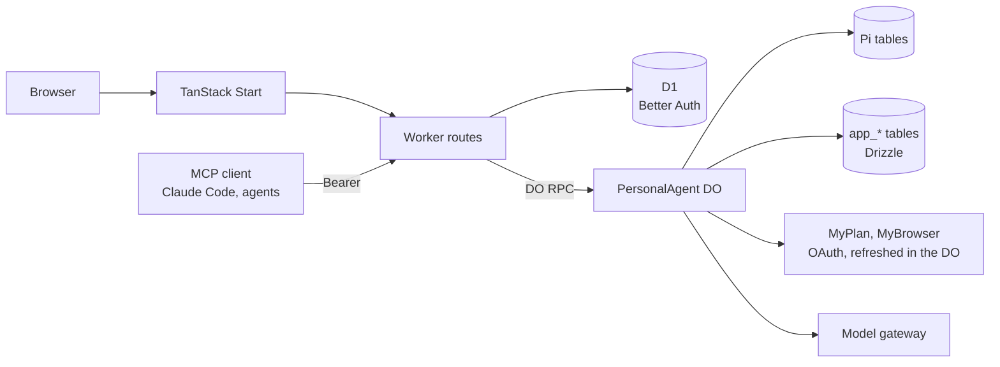

# Architecture

One Cloudflare Worker serves the web app and the API. Behind it, every user has their own `PersonalAgent` Durable
Object, named by their user ID: it runs Pi, holds that user's outbound MCP connections and credentials, and keeps
application state in its own SQLite. D1 holds Better Auth's account tables (users, sessions, inbound OAuth) and Purrable's `app_billing_*` tables.

## Worker

`apps/web/src/worker.ts` sends pages to TanStack Start and the routes below to `apps/runtime/src/worker.ts`.
Runtime paths below are relative to `apps/runtime/src/`; browser paths are relative to `apps/web/src/`.

| Path | What happens |
| --- | --- |
| `/health` | Stage, service name, sign-up mode and whether mail is configured. |
| `/.well-known/oauth-protected-resource*` | Protected-resource metadata for `/mcp`. |
| `/.well-known/*`, `/api/auth/*` | Better Auth: sign-up and sign-in, the OAuth authorization server for inbound clients. |
| `/mcp` | Purrable's own MCP server; a Bearer token from an inbound client reaches the agent of the user who consented. |
| `/api/*` | Owner API. A session cookie selects the signed-in user's agent; writes reject an `Origin` header if it names another origin. |
| `/hooks/mcp-events/<userId>/<token>` | Signed MCP Events; the user-bound route token is checked before object lookup. |
| `/hooks/myagent/<userId>/<token>` | Legacy Telegram doorbell fallback for servers without Events. |

## Accounts

Anyone may sign up when `PURRABLE_SIGNUP_MODE` is `open`; with `invite` the request needs the
`PURRABLE_SIGNUP_INVITE_CODE` in an `x-invite-code` header; `closed` (the default for deployed stages) refuses every
sign-up. When the deployment sends mail, the usual way in is a six-digit code mailed to the address (ten minutes, five
tries, one per address per minute; `auth/email-code.ts`): a known address signs in, a new one gets an account through
the same sign-up gate, already verified. Passwords remain as the fallback. A signed-in user can add passkeys in
Settings (`auth/passkey.ts`, the myapps policy: Purrable's own host is the relying party, credentials are discoverable
and must verify the person; adding one needs a sign-in from the last 10 minutes) and then sign in with one without
typing an email. A passkey never creates an account, and an MCP client's authorization resumes after it like after
any sign-in. With `PURRABLE_MAIL_SENDER` set (an address on an apex onboarded for Cloudflare Email Sending), a new
password account needs email verification through an emailed code or the one-hour link (`auth/mail.ts`); the link
signs them in. The same sender carries password-reset links (`/reset-password`); a reset signs every device out, and
asking for one never reveals whether an address has an account. A deployed stage refuses to deploy `open` sign-up
without a sender. Sign-up, verification mail and sign-in are rate limited per `cf-connecting-ip` in D1 (auth runs per
request, so in-memory limits would reset every call). The agent a request
reaches is always derived from authentication, the session's user ID or the inbound token's subject, never from the
request alone. The Telegram hook instead verifies a token bound to its user ID before selecting an agent.

Deleting an account (Settings; the password, or a sign-in within the last 10 minutes) first erases the user's agent through `Agent.destroy()`: every Pi,
Agents and application table, its alarm, and its isolate. Only then does Better Auth delete the user, and D1 cascades
their sessions, passkeys, consents and tokens. If erasing the agent fails, the account stays so the user can retry. Outbound
OAuth tokens are forgotten, not revoked at the remote server. Users share the deployment's model key and configured
MCP server list; their added servers, conversations, connections, credentials, grants and resident authority are per agent.

The owner API forwards to the agent object over DO RPC. Workers RPC drops custom error classes, so every DO method
returns an encoded `RpcResult`; the Worker decodes it and maps the tagged error to a status in one place
(`http/errors.ts`, `http/respond.ts`). Failures are logged as one JSON line with route, request ID, status and
error tag, never bodies or credentials.

## Workspace authority

Auth D1 also stores additive `app_*` workspace access metadata through Drizzle. Browser selection is session-bound
and membership checked; only a verified workspace owner's ID names the Agent. Foreign IDs return 404, stale context
returns 409, and selection writes require exact Origin plus `x-purrable-csrf: 1`. Hooks and inbound MCP remain bound
to the verified owner's workspace. Ordinary accounts can provision a personal workspace; invitation-only accounts
never fall back to a personal Agent. Existing objects and Pi history keep their original names.

Invitations store only hashes of a fragment secret and separate strong code. Public proof exchange requires exact
Origin and CSRF headers, is rate limited, and issues a ten-minute HttpOnly admission bound to the email and current
invitation version. Closed signup checks that admission at OTP send/verify and account creation. Acceptance requires
a fresh verified session and the acting account's plan, then commits membership and proof consumption in a D1 batch.
Operation receipts and version CAS protect owner changes; replay never restores removed access. Resend rotates
proofs. Transactions finish before mail or owner grant RPCs, and members cannot invoke owner grant validation while
leaving. The workspace limits pending/active invitees to sixteen and mail attempts to ten per hour.

Members/viewers cannot reach owner RPCs in Phase A. Shared execution waits for trusted principal contexts, capability
scope, visibility and acting-account usage in Phase B. The owner reads all; each member needs their own Pro plan.
Deletion commits a closed workspace before native destruction and leaves failure retryable. Member account deletion
revokes memberships without destroying another owner's Agent. See [ADR 0014](adr/0014-members-and-workspace-authority.md).

## The agent object

`PersonalAgent extends Agent` and registers the native `PiHarness` with the Agent lifecycle. Pi owns transcripts,
tasks, submissions, recovery and tool replay. The object builds one Effect `ManagedRuntime` lazily, providing its
services: `Mcp` (the MCP host), `Resident` (resident authority), `Conversations` (the conversation registry),
`Budget`, `Models`, `Memory`, `Skills`, `Learner` and `Channel` (`services.ts`). DO methods are thin: each runs one Effect
program and encodes the exit. PiHarness and Pi Durable are experimental; Alchemy is a pinned beta and Drizzle an RC.

Conversations (`conversations.ts`): every agent has one **main** conversation, Pi's root session `1`, where the owner's
browser and every inbound MCP client talk. A message from anyone but the owner's browser starts with an author tag
block (`[from Claude Code]`, the `authorTag` contract), so the model and the web both know who wrote it. Side
**threads** are Pi conversations of their own: branched from a message of main (a Pi fork at that entry, so the thread
sees main up to there and main never sees the thread) or empty. `app_conversations` registers each one with its kind,
title, origin and archive time; a session id reaches Pi only if it is registered there, so no request opens a
conversation by guessing its number. Pi cannot delete a conversation, so archiving only hides a thread. The web
lists them in the app's sidebar (`components/app-sidebar.tsx`, a sheet on phones): `/` is main and `/t/:id` a
thread. Main attaches threads to their parent message with a connector rail and an indented preview
(`components/thread-replies.tsx`). Blocks are expanded by default: the first five messages show their author, clipped
text, and quiet thought/tool lines; a busy mark follows current activity. The owner can collapse each block, with
that device preference in guarded localStorage. An IntersectionObserver starts the compact owner-scoped preview read
only near the viewport, then polls while visible. After five messages only activity and the remaining count change.
Owner-started threads get the same block. Open thread, the remaining-replies action and active sidebar threads
open independent panes beside main (`/?thread=<id>`) with their own composers. The URL identifies the most recently
opened thread; earlier panes stay open. `/t/:id` still gives the full conversation, including archived threads. Reply in thread opens a reply there
(`/?reply=<entry>`) that branches the thread only when it is sent, because Pi cannot delete a conversation; the
sidebar's "+" beside Threads opens an empty draft there (`/?new=true`) the same way. A thread started with "+" tells
main its name once it has one (ADR 0010): main gets one `app.thread_started` note, `[thread started: "<title>"]`, and
its transcript shows a row for that thread. The owner API is conversation-scoped:

| Route | Purpose |
| --- | --- |
| `GET /api/threads` | List registered conversations, including archived ones. A live thread also carries where it branched (`forkEntry`) and its own `replies` and `lastReplyAt`, counted from Pi (`replies.ts`). |
| `POST /api/threads` | Create an empty thread (`{}`) or branch main at an entry (`{ from: <entry> }`). |
| `PATCH /api/threads/:id` | Rename or (un)archive a thread or subagent. Main cannot be changed this way. |
| `GET /api/threads/:id/capabilities` | What the conversation lets its agent use (`ConversationCapabilities`): each server with a granted tool and those tools, each skills library, subagents, and for a thread whether it has main's switches. |
| `PATCH /api/threads/:id/capabilities` | Switch one `CapabilityTarget` on or off there (only what is shown can be switched off), or `{ reset: 'main' }` a thread back to main's switches. A subagent's are not editable. |
| `POST /api/threads/:id/messages` | Submit `input`, a stable `operationId` and optional `appContext`; returns 202 acceptance. |
| `POST /api/threads/:id/stop` | Stop a conversation or one `operationId`. |
| `GET /api/threads/:id/snapshot`, `GET /api/threads/:id/events` | Pi snapshot or SSE snapshot followed by committed batches. |
| `GET /api/threads/:id/preview` | First five own messages (bounded text and quiet tool/thought lines), remaining replies and busy state; no inherited main history. |
| `GET /api/threads/:id/history?before=<entry>` | Earlier entries, oldest first, with a `more` flag. |

Every thread runs the `purrable.thread` extension (`pi/thread.ts`), added to that conversation alone when it is made;
main never has it. It tells the model it is in a side thread and offers `share_to_main`: when the owner asks (the
thread's "Share to main" button sends that request), the model writes a short note into main as a Pi write
submission, an `app.shared` entry labelled `[from thread "<title>"]` that keeps the thread's id, so the label in
main's transcript opens that thread. Main's model sees it from its next request and answers nothing, since a write
starts no run. After each response an untitled thread is named by the memory model
from its latest exchange, in the background; the owner can rename it. A thread started with "+" is created with
`app_conversations.main_note = 'owed'`; once it has a title (the model's or the owner's) the same hook writes main
an `app.thread_started` entry with request id `thread-started:<id>` and marks the note `written`. The note carries
only the name, never what was said in the thread, and a later rename does not rewrite it. Branched threads already
show under their message in main and get no note.

Main and threads can start **subagents** with the `subagent` tool (`pi/subagents.ts`, after Pi Durable's background
subagent example): `spawn`, `send`, `stop` and `status`. A subagent is a Pi conversation owned by a background anchor
task of its spawner, so the spawner's Stop and idle waits do not reach it. It starts with the spawner's model and is
given exactly the persona and the owner's MCP and budget extensions: the same grants, no subagents of its own, no
`ask_user` and no skills. Each message goes through a reporter task that delivers it, waits for the answer and posts
it into the spawner as an input labelled `[from subagent <name>]`, which the spawner answers; request ids keep a
restart from delivering or reporting twice. At most three subagents work at once. The reporter registers the subagent in
`app_conversations` under its spawner, so the web lists it there and the tool row links to it.

**Capabilities** (ADR 0010, `capabilities/`): each conversation can switch off, for its own agent, a connected server,
one granted tool of it, a skills library, or subagents. `app_conversation_capabilities` stores only what is off, so a
tool granted later is on everywhere. `CapabilityProfiles.scope(session)` is the one gate: a conversation's own switches,
and for a subagent those of every conversation above it, read live (an unregistered session may use nothing). A thread
copies main's switches as it is registered; "Reset to main's setup" copies them again. What is off is hidden from the
model there: `mcp_list` leaves it out, the `skills` section does not list or fetch that library, and Pi's
per-conversation tool filter (`configure({ tools: { remove } })`) drops `subagent`, whose section then hides too. A call
that still arrives runs nothing: `mcp_call`, `skill_activate`, `skill_read` and `subagent` check the scope before
anything else (before the grant check or any connection) and return an error result with details
`{ kind: 'capability-off', target }` (`pi/capabilities.ts`), which the web turns into an owner-only "Turn on here"
card. In a subagent the result has words only. The owner's console and an App's own calls carry no conversation and
are not narrowed; Telegram and inbound clients talk in main, so main's switches cover them.

The persona contributes two static system-prompt sections (`pi/persona.ts`): who the agent is, and that remote content
is untrusted data. The `mcp_list` and `mcp_call` tools (`pi/resident-mcp.ts`) are how the model reaches the owner's
MCP servers; both require current resident authority, and `mcp_call` is marked unsafe to replay.

`ask_user` (`pi/ask-user.ts`) is how the agent asks the owner something. It takes one to five short questions:
single choice, multiple choice or free text. The tool result is the questions as numbered plain text, with details
`{ kind: 'question', questions }` (the `QuestionSpec` contract). It ends the run with `control: { terminate: true }`,
so no model call waits on a person. The answer is the owner's next ordinary message, whether it comes from the web
card or any other channel. A question counts as settled once a later user message exists.

The browser follows a conversation over Server-Sent Events: a snapshot of committed Pi entries, then batches, with
a heartbeat. On reconnect it starts again from a fresh snapshot.

Every signed-in page sits beside the app's sidebar (shadcn's sidebar, ported to `packages/ui`): the conversations,
then Connections, Settings and Sign out. On desktop it slides away (the toggle in each page's top bar, or ⌘/Ctrl+B)
and a cookie remembers it, which the server reads so the first paint has the right layout; on phones it is a sheet.
The chat view fills the page beside it. The transcript scrolls in a `MessageScroller` (from `@shadcn/react`). Each of
the owner's turns is a scroll anchor. The view follows a streaming reply only while the reader is at the end, and
otherwise offers a jump back. The top bar (the toggle, the conversation's name, its actions) and the composer float
over the transcript as translucent chrome. Assistant Markdown is set by shadcn/typeset, whose append-stable rules keep earlier blocks still
while a reply streams.

When the agent waits on the owner, the request is pinned above the composer until their next message
(`lib/interactions.ts`). This covers `ask_user` questions (a questionnaire) and grant-required results (an Allow card
for the exact server and tool). The reply is an ordinary message with a stable operation ID: `answer:<callId>` or
`grant:<callId>`. Allow first sets the exact grant through `PUT /api/mcp/grants`, and the allowed tool stays allowed.
In the transcript, both requests leave a quiet receipt. An Allow card is only trusted from Purrable's own result for
the tool that was called, never from a remote result, which always carries `origin`.

The composer carries the agent's presence (`lib/presence.ts`): one state for the whole agent, with the most urgent
first. In order: offline, waiting for the owner, retrying, using a tool (named `server · tool`), writing, thinking,
budget spent, no answer, and ready. A small orb of moving colour (a Paper Shaders `MeshGradient`, loaded lazily)
shows it beside a text label, and its pace follows the work. While the agent waits on the owner, a pulsing border
frames the composer. Under reduced motion, in a hidden tab or before the shader loads, the orb is a still gradient and
the border is absent. Colours come from the theme's `--presence-*` tokens, resolved to RGB at runtime.

## Outbound MCP

Servers come from `PURRABLE_MCP_SERVERS` (JSON: `serverId`, `endpoint`, optional `issuer` and `resource`) and from
the owner, who may add up to sixteen by URL (`app_mcp_servers`, ADR 0006). An added endpoint is a public https
address (`mcp/endpoint.ts`), and its server card labels it as the server's own claim. Configured servers win on ID
and cannot be removed. Removing an added server forgets its row, endpoint binding, credentials, pending sign-ins and
grants in one transaction. Connections also offers a shelf of suggested servers (`mcp/suggested.ts`), with source
comments recording their connection checks. One tap adds and connects. It also searches MCP registries that speak
the generic registry API (`mcp/registry.ts`, `GET /api/mcp/catalog?q=`): the Official MCP Registry and GitHub's, built
in, then up to eight the owner adds (`app_mcp_registries`). A registry is
added only once it answers `/v0.1/servers`, and removing it keeps the servers added from it. Search reads one page of
up to twenty entries per registry and keeps https streamable-HTTP remotes, rejecting entries explicitly marked
inactive or not latest. Missing status metadata is accepted. Results are labelled by registry, each server once
(the official registry first), and cached for ten minutes. Endpoint placeholders are filled with one safe path
segment each, and servers that require a secret header are listed but cannot be added yet. An added entry records
its registry, name and version. The owner connects each server from the Connections page:

1. `POST /api/mcp/:id/connect` first tries without sign-in. If needed, it runs the MCP SDK's `auth()` with our
   `StoredOAuthProvider`: discovery, dynamic client registration, PKCE. Only a flow needing consent returns a remote
   authorization URL; otherwise it returns `{}`.
2. The remote server redirects to `/api/mcp/oauth/callback`. The pending state is single-use and expires after ten
   minutes; the code is exchanged and the tokens stored.
3. Client registration and tokens are AES-GCM encrypted at rest (`PURRABLE_CREDENTIAL_KEY`, bound to server ID and
   purpose); discovery metadata is stored in plain JSON.

Credentials and grants belong to the endpoint they were made for (`mcp/endpoints.ts`, `app_mcp_endpoints`). When the
agent starts and a server ID now points at another endpoint, everything stored for it is dropped in one short
transaction: credentials, client registration, pending authorizations and grants. The owner connects and grants
again, so tokens issued by one host never reach another.

Calls go through the `McpConnectionManager`, keyed by server ID, which caches a connection and closes it after five
minutes idle. Its auth provider refreshes a token a minute before expiry, single-flight per server, and refreshes
once after a 401. A refused refresh marks the server `needs_auth` and the owner reconnects. Results are bounded (1 MiB,
16 MiB for App HTML).

Grants are per discovered tool (`app_mcp_grants`), toggled by the owner. A tool grant also grants its `ui://` App
resource. "Allow app" (`PUT /api/mcp/app-grants`, `McpHost.setAppGrant`) grants an App as a whole: exactly the tools
that declare its `ui://` resource, including the ones only the App may call, and the resource itself. Connections
lists those tools under the switch, each still adjustable. Tool annotations from the server are shown but never
grant anything. Disconnecting forgets credentials and keeps grants. When the model calls a tool that exists but is
not granted, nothing runs. `mcp_call` returns an error result whose details are
`{ kind: 'grant-required', serverId, name }`, and the model is told to wait.
`mcpModelResult` details never carry a top-level `kind`, so remote content cannot forge one. The web turns that
result into an owner-only Allow card. A conversation can switch servers and tools off for its agent (Capabilities,
above); that check comes first, and switches are forgotten with the server's grants.

## Skills

Skills come from MCP servers that declare the MCP Skills extension, and only from those the owner turns them on for
in Connections (`app_skill_sources`, ADR 0008). The client declares the extension; `McpConnectionManager.listSkills`,
`getSkill` and `readSkillFile` speak `skills/list`, `skills/get` and `resources/read`, with the shapes decoded in
`skills/protocol.ts` because the SDK has no Skills support yet. The current library activates entries from
`skills/list`; `getSkill` is available in the connection manager.

`SkillLibrary` (`skills/library.ts`) keeps each enabled server's listing for its `ttlMs` (30 s to an hour) and names
every skill `<server>:<name>`. The `purrable.skills` extension (main and threads, not subagents) renders that list in
its `skills` section, refreshing an expired listing when the section is evaluated, and offers `skill_activate` and
`skill_read`. Activation reads `SKILL.md`, checks size, SHA-256 and frontmatter against the entry (`skills/verify.ts`),
and records the entry for the conversation (`app_skill_activations`). `skill_read` reads only files in that retained
manifest, so a conversation
stays on the version it activated. Verified bytes are cached by digest (`app_skill_files`) and checked again on every
read. A corrupted cache row is rejected and repaired by a verified refetch (local workerd regression evidence). A
local workerd restart preserves the activation manifest and cached bytes, then reads the same version without a network
call.
An unreachable server keeps its last listing while it remains cached in the isolate, or is reported unavailable.
Dynamic skills are declined; skill scripts can be read but are never executed. Enabled skills are procedures the agent
follows, but they grant no permissions and cannot override the owner. Disabling the server stops new activations and
file reads; instructions already in a conversation stay there. A conversation can switch one library off for itself
(Capabilities): its section leaves the library out without fetching it, and its activations and reads are refused.

After a final answer (`onYield`), the learner (`skills/learner.ts`) looks at the latest user message. On a correction
or a request to keep how something was done, the memory model decides whether the exchange teaches a procedure. A
procedure becomes a draft sent through an enabled library's granted `skill_draft` tool, which the owner reviews in the
library. The Worker logs the learner outcome and conversation id without transcript or draft content. At most five in a rolling 24 hours, never the same content twice, no new draft while one for that skill is open,
and never a rejected draft again (`app_skill_drafts`). A grant for `skill_draft_status` lets the learner refresh review
status; a deterministic workerd test confirms a rejected draft is not submitted again for the same lesson. Draft
payloads contain generated procedure text and brief evidence, with email- and secret-shaped strings
scrubbed, and no transcript field. The learner's model call counts toward the budget.

## MCP Apps host

An App is a tool's `ui://` resource, served by the server that answered the call. It runs in two nested opaque
sandboxed frames (`lib/app-sandbox.ts`). The outer proxy only relays protocol messages to and from the host's origin.
Its calls go through the owner API to the originating server and need that server's grant.

The chat view has at most one live App (`components/apps`). At 75rem and wider, `components/workspace-layout.tsx`
mounts Trellis 0.3.0 after hydration. Main is a nonclosable stage view. Thread/draft panes and the App slot can dock,
float, tab and resize; stable portal hosts retain React pane state during rearrangement. Narrow screens render main
and use the existing thread and App sheets. Server rendering shows main alone.

Pane metadata and the bounded Trellis document use separate version-1 localStorage records, scoped to the authenticated
owner and primary conversation on this device. Restore migrates old thread lists and prunes archived/missing threads,
unknown view types and stale App panes. App selections and grants never come from storage. Reset layout creates equal
splits for the current panes. Tokens follow the local shadcn dark/light palette; the toolbar credits Trellis and Dan
Fessler. See [ADR 0016](adr/0016-workspace-layout-with-trellis.md) for the license arrangement.

The App iframe remains in the fixed `AppLayer` stage outside Trellis. Trellis moves an empty measured slot, so docking,
undocking and responsive changes never reparent the opaque frame or replace its bridge. The stage follows that slot
frame by frame; hidden tabs hide it, and clipping respects floating panes above it. Fullscreen fills the workspace
surface. The advertised modes are inline (the desktop pane) and fullscreen. Narrow screens use a momentum/snapping
bottom sheet for fullscreen; inline waits behind Open in the transcript. Changing selection tears down the old bridge
and reconnects through the new originating server. Grant cards, link offers and context sharing remain host-drawn.

The App learns the host context (`lib/host-context.ts`): theme, our tokens as MCP Apps style variables, device,
locale and time zone, its display mode, the modes on offer, and its measured box. The host re-sends it when these change.
Desktop resizing controls the pane height; the App's own height request remains bounded for narrow/standalone use.

Two more requests are drawn by the host, where the App cannot reach (`lib/app-context.ts`). A link the App asks to
open (https only, no credentials) becomes an offer with a real anchor, so only the owner's click opens it. Context
the App shares for the agent (`ui/update-model-context`, text or structured content rendered as JSON, at most 8192
JavaScript string units) waits in a removable chip above the composer and travels once, with the owner's next message,
as `appContext` on `POST /api/threads/:id/messages`. The runtime (`pi/content.ts`) appends it after the owner's words as
a separate block shaped `{ origin: { serverId, trust: 'untrusted' }, appContext }`. The persona treats it as data, never as the owner
speaking, and the transcript shows it as a note under their message.

An App's own call to a tool the owner has not granted does not fail at once (`components/apps/grant-ask.tsx`). It
waits on a card the host draws in the App's chrome, naming the exact tool. Allow grants that one tool and runs the
same call again. "Not now", or two minutes without an answer, returns the denial to the App.

## Main's memory

Main never ends, so it keeps a memory instead of an ever-longer context (`memory/`, after VictorTaelin's OptChat
gist). Every message of main since the memory was activated is logged in `app_memory_log` with its Pi entry id:

- the owner's and other authors' words, notes shared from threads, and the notes naming threads started with "+";
- the agent's replies, with their tool calls;
- tool results.

System entries and thinking are never logged. Memory text keeps at most 12 000 JavaScript string units from each
message's head and tail, plus a truncation note (`memory/log.ts`); Pi retains the original entry. This also bounds a
single-message `zoom`.

A background builder task (`pi/memory.ts`), which main starts after each of its responses, summarizes each message in
order into one line of about 512 bytes with the memory model. It then merges adjacent lines in pairs into a binary
tree (`app_memory_nodes`). A short message, or a pair that fits, is its own line word for word, with no model call.
The view folds the tree toward 48 000 bytes (`memory/tree.ts`): one line per recent message, and older lines covering
more messages, merging the pair that is oldest relative to its size first. Only the merges the view needs are built.

The builder writes the view into main as an `app.memory` entry, a Pi write submission whose head is main's newest
input, which is how Pi places a compaction. The model then sees the view and, verbatim, everything from that input
on, so nothing waits for the summarizer. `zoom(id, n)` (the `purrable.recall` extension) opens a line into the two
under it, down to a single message. It is offered in main and in threads branched from it; a branched thread is
bounded at its fork.

The summarizer's tokens count toward the budget, and the builder stops once the budget is spent. The memory begins at
activation: older history stays in Pi, out of the model's context once the first view lands. Once a view or a
compaction starts a conversation's snapshot later, the web reads the earlier entries through
`GET /api/threads/:id/history?before=<entry>`; it never shows the marker entries themselves. Settings shows how many
messages main remembers.

## Models

Each user picks the model their agent answers with, in the composer. The deployment offers `PURRABLE_MODEL_ID` (the
default) plus `PURRABLE_MODELS`, all served by the same LiteLLM key; `models.ts` names and groups them by route
(Google, Alibaba Cloud), because quota runs out per route. The pick is one row in `app_model_choice`; without one, or
when the deployment stops offering it, the default applies. Pi stores one model per conversation, set when it is
created, so before each turn the agent calls `session.setModel` for the conversation the turn runs in, skipping it
when that conversation already has the model. Every offered model is registered with
Pi's `Models` under the one `purrable-litellm` provider. A failed model call shows its reason in the chat, and a
quota or outage failure points at the picker.

Housekeeping (thread titles, main's summaries and skill-draft decisions) runs on `PURRABLE_MEMORY_MODEL`. Set it to a
cheap offered model; the code does not choose by price. Unset or not offered, it falls back to the default
(`models.ts`, `memory/model.ts`). Its tokens count toward the owner's daily budget like any other.

## Model budget

Users share the deployment's model key, so each agent has a daily token budget (`PURRABLE_MODEL_DAILY_TOKENS`,
default 300 000, per UTC day). A Pi extension (`pi/budget.ts`) records every model response's tokens in
`app_usage_daily`. Once the day is spent, new turns are refused with `BudgetExhausted`: HTTP 429 from the owner API,
or a tool error from `/mcp`. Telegram submissions check the same budget. Tool calls inside a running turn are blocked,
so a looping turn ends after one more reply. Pi reports and swallows exceptions thrown by hooks, so the in-turn lever
is blocking tools, not throwing. Settings shows today's usage, and the composer shows it as a ring, re-read whenever
a run ends. On wider screens the composer also
shows how full the context was at the latest response, measured against the model's `contextWindow`. The model key's
own cap stays the backstop.

## Resident authority

The agent acts for the owner when the owner is not there, so it needs its own standing permission rather than a
borrowed browser session. `ResidentAuthority` (`app_resident`) is active for 30 days. Owner RPC calls renew the window;
inbound calls and hooks do not. Revoking it in Settings sticks: activity does not re-enable it, only the explicit toggle
does. Model MCP tools, skills, inbound `ask_agent` and scheduled Telegram pulls and replies require current authority.
Owner MCP RPC methods renew it but do not call `requireResident`; their tool/resource calls still check exact grants
(`agent.ts`, `pi/resident-mcp.ts`, `pi/skills.ts`).

## Inbound MCP

Purrable is an MCP server at `/mcp`, the protected resource of Better Auth's `mcp()` authorization server:

- Clients register dynamically (open, but restricted to the `/mcp` resource). A registration whose redirects are
  all http loopback is marked native, which is how Claude Code registers.
- The owner signs in and consents at `/consent`. A Bearer token is accepted only if it verifies against the local
  JWKS, names `/mcp` as audience, comes from an enabled client and the owner's consent still exists.
- Tools: `ask_agent` (submit into main, labelled with the client's name, and wait up to 110 seconds; a stable
  `operationId` makes it idempotent) and `get_recent_messages` (main's latest messages, with their authors).
- Revoking a client in Settings deletes the consent, disables the client and revokes its refresh tokens; its next
  call gets a 401.

## MCP Events and Telegram

The owner selects one Telegram connection under **Use for Telegram** (ADR 0011). If its authenticated discovery
advertises top-level `capabilities.events`, the action grants `inbox`, `send_message` and the exact Events selectors
`message.received` and `question.answered` with `{}` arguments. Both finite webhook subscriptions must confirm before
`app_telegram_channel` copies the checkpoint and fences old doorbell cursor writes. The channel pulls immediately;
a failure before that fence leaves the old channel checkpoint intact. A server without Events retains the legacy
`subscribe`/`unsubscribe` doorbell transport. Connections shows the active transport.

`POST /hooks/mcp-events/<userId>/<token>` verifies the user-bound token before lookup. Inside the object, Standard
Webhooks HMAC and five-minute freshness checks precede decoding. A pre-persisted subscribe intent accepts an early
signed verification challenge; remote ids are cross-checked when subscribe returns. Receipts and their frozen consumer
revisions commit in short transactions, with an already armed recovery schedule. The hook returns quickly and dispatch
runs asynchronously. Replay wakes unfinished handlers without duplicating their accepted intent.

`message.received` and `question.answered` both pull the authoritative inbox into main. `ask_user` ends its turn;
the answer arrives as the owner's next inbox message. The existing id mapping is preserved: `tg:123` becomes
`telegram-tg-123`, and reply operations keep their sanitization/truncation. Main's replies and subagent reports go
back with `send_message`, escaped and chunked, using `app_channel_replies`. Submission acceptance is distinct from
external Telegram completion. Disabling cleans up Events while authority is available, then tombstones locally;
finite remote leases expire if authorized cleanup cannot run.

The dispatcher also binds MySkills `skills.updated` and `skills.list_changed`. Their payload is untrusted metadata;
the handler persists a dirty catalog generation and invalidates the cache before acknowledgement. A listing can
clear only the generation it observed, and retained activations stay pinned. Gap controls trigger reconciliation;
termination stops lease refresh and surfaces health. Mail and workspace changes have no installed consumer yet.

The client refreshes before the producer's ISO `refreshBefore` and polls on gaps or webhook outages. Bounds are
32 subscriptions, 100 events per page, 256 KiB bodies, five-second remote requests and 10,000 pending rows / 32 MiB.
Recovery sweeps process at most 256 deliveries and retain completed receipts for eight days; unfinished receipts
are never pruned. Workers cannot pin resolved DNS IPs; trusted DNS is the documented v1 deviation (ADR 0011).

## Storage

| Store | Tables | Owner |
| --- | --- | --- |
| Agent DO SQLite | `pi_*`, `cf_agents_*` and the other vendor tables | Pi, Agents SDK. Never touched. |
| Agent DO SQLite | `app_mcp_servers`, `app_mcp_registries`, `app_mcp_endpoints`, `app_mcp_credentials`, `app_mcp_oauth_pending`, `app_mcp_grants` | Drizzle: MCP metadata and authorization. |
| Agent DO SQLite | `app_resident`, `app_conversations`, `app_model_choice`, `app_usage_daily`, `app_metadata` | Drizzle: agent metadata. |
| Agent DO SQLite | `app_conversation_capabilities` | Drizzle: what each conversation switched off (ADR 0010). |
| Agent DO SQLite | `app_memory_log`, `app_memory_nodes`, `app_memory_state` | Drizzle: main's memory. |
| Agent DO SQLite | `app_skill_sources`, `app_skill_activations`, `app_skill_files`, `app_skill_drafts` | Drizzle: skills and draft tracking. |
| Agent DO SQLite | `app_channel`, `app_telegram_channel`, `app_channel_replies` | Drizzle: Telegram transport checkpoints and replies. |
| Agent DO SQLite | `app_mcp_event_grants`, `app_mcp_event_subscriptions`, `app_event_deliveries`, `app_mcp_event_consumers`, `app_event_consumer_receipts` | Drizzle: exact Events grants, leases, encrypted receipts and independent acknowledgements. |
| Agent DO SQLite | `app_skill_catalog_state` | Drizzle: durable catalog invalidation generations. |
| D1 `PurrableAuth` | `user`, `session`, `account`, `verification`, `jwks`, `rateLimit`, `passkey`, `oauth*` | Better Auth, `apps/runtime/migrations`. |
| D1 `PurrableAuth` | `app_billing_accounts`, `app_billing_subscriptions`, `app_billing_inbox`, `app_billing_checkouts` | Drizzle: account payments and durable reconciliation. |

Application tables are declared in `storage/schema.ts` and migrated inline in `storage/migrations.ts`.
`app_client_sessions` was dropped when inbound clients moved to main; it is not a current table.

Better Auth lives in D1 because the Durable SQLite adapter's async transactions and affected-row semantics do not
meet its contract (ADR 0001). SQLite transactions are short and never span model or network calls.

## Infrastructure

`apps/web/alchemy.run.ts` declares the Vite Worker, the `PersonalAgent` namespace and the D1 database; it is the only
deployment entrypoint. The local stage runs in workerd with CLIProxy; the dev stage calls Railway LiteLLM with a
dedicated model-limited, budget-capped key. Offered models and price weights come from stage configuration; the per-account allowance comes from its plan or
operator override. The key's provider caps and shared quotas are managed outside this repository; source does not prove
their active values. Secrets are Worker secret bindings, never in the browser bundle.

## Stage origins

The `prod` stage has its own `purrable-prod-auth` D1, native Agent namespace, secret bindings and model key; `dev`
retains its existing resources and data. Alchemy attaches the per-stage `PURRABLE_DOMAIN`, and prod's `www` alias.
Both Worker entry points redirect alternate origins before auth, hooks or page rendering: 301 for GET/HEAD, 308 for
other methods. Redirects preserve path/query and use only `APP_URL` as their authority. Passkey rpID, trusted origins,
mail links and inbound MCP metadata also derive from that configured origin. Dev passkeys must be remade after the
host changes; email codes remain the recovery path. Inbound clients re-authorize and outbound DCR clients reconnect.
Mail subjects include the host outside prod; prod subjects have no stage prefix. Domain and sender acceptance are
separate operator checks; local workerd proves the redirect behavior.

The inbound Agents SDK handler explicitly allows only the configured `APP_URL` hostname for both Host and browser
Origin validation. The SDK defaults otherwise reject browser requests on custom domains. A native workerd regression
proves a custom-domain Origin succeeds and a foreign Origin is rejected.

## Plans and payments

The account boundary in auth D1 is independent of the agent's Pi store (ADR 0015). `billing/` owns customers,
subscriptions, checkout rate accounting and the verified webhook inbox through Drizzle `app_billing_*` tables. Better
Auth continues to own identity and inbound OAuth. No billing operation writes Pi or Agents tables.

`GET /api/billing/state`, `POST /api/billing/checkout` and `POST /api/billing/portal` authenticate the owner without
resolving an Agent. Product and checkout metadata are selected server-side. Checkout and the return page grant no
access: `POST /hooks/dodo` verifies Standard Webhooks HMAC over the raw body, checks freshness and stores the first
body under `webhook-id` before responding 2xx. A leased background run updates the subscription; an hourly Worker cron
retries unfinished receipts and reads stale subscriptions back from Dodo. Provider timestamps prevent old events
from overwriting newer states. This is durable idempotent reconciliation, not exactly-once provider effects.

Worker APIs, inbound MCP and user-bound hooks require an active plan before selecting the user's Agent. Agent owner,
client and background runs also check the shared `Entitlements` service. It reads current account state at admission,
without a cached plan or a lifecycle lock around D1/network waits. Pro is $10/month, without trial or free tier; active
or cancelled subscriptions remain usable only through their recorded paid period. Failed renewals use the provider's
grace end or three days after the period end; missing dates fail closed. Existing users at the billing migration get a
dev-only override, which grants nothing on prod. Operator overrides may supply their own allowance.

Each Agent's usage ledger still records its owner's UTC-day spend, while the allowance now comes from that account's
plan (2M/day for Pro). Optional configured model price multipliers count weighted tokens in Pi replies and cheap
memory/title calls, with weight one for omitted models. The price schedule needs operator review. Member attribution
across another owner's Agent will be added with Members; M1 accounts for the current one-owner agent model.

The browser reads billing state before mounting agent pages; unpaid accounts reach `/subscribe`. The return page
polls verified state and Settings opens the Dodo portal. `/terms`, `/privacy` and `/refunds` are draft public pages,
pending operator identity and legal review. Native workerd tests verify signup, injected checkout, activation,
replay, stale updates, cancellation, grace and per-account allowances with real D1/Agent storage. They do not prove
live Dodo delivery or merchant onboarding.

## Isolated memory experiments

The [benchmark workspace](../bench/README.md) replays private, redacted coding histories through native Pi write
submissions in its own local workerd actors. OptChat, native compaction and lexical archive search share fixed source
cutoffs and bounded API/retrieval allowances. Source tool calls are transcript evidence; the benchmark installs only
recall/search tools and never executes historical commands. Expected claims stay on the coordinator host, outside
worker requests. Private manifests, source hashes, API ledgers, native contexts and identity-bound semantic reviews
make runs inspectable. This local recall experiment does not mutate a deployed user's agent or prove coding continuation.
