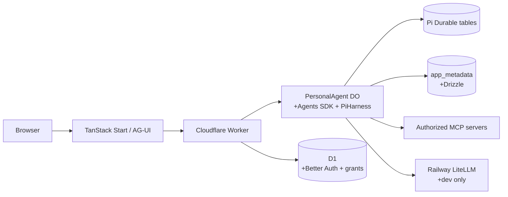
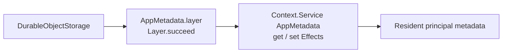

# Architecture

Purrable is a Cloudflare Worker with a native Agents SDK Durable Object. The object is the resident agent boundary; Pi Durable owns conversation and execution state, while application services add authentication, MCP grants, and metadata.

`PersonalAgent extends Agent` and registers the native `PiHarness` with the Agent lifecycle. Pi owns transcripts, tasks, submissions, recovery, and extensions. Drizzle is limited to `app_metadata` and its migration journal; vendor tables (including `cf_agents_*` and `pi_*`) are protected. Better Auth uses `mcp()` and `jwt()` in a separate D1 database because the pinned Durable SQLite adapter does not satisfy the required asynchronous transaction and affected-row behavior.

The web application projects committed Pi state through AG-UI. MCP Apps run in a sandbox over their originating authorized connection. Grants bind the authenticated principal, configured server identity, and capability; tool annotations and remote content are untrusted data.

Alchemy (`2.0.0-beta.80`) is the sole infrastructure entrypoint. It declares one Vite Worker, the `PersonalAgent` Durable Object binding, and a separate D1 auth database. The local stage uses CLIProxy; the retained dev stage uses the dedicated Railway LiteLLM key. No production deployment or external side effect is implied by local tests.

See implementation status, stack compatibility, MCP compatibility, and [ADRs](adr/0001-runtime-and-auth-storage.md).

The current Effect service seam is deliberately small:

This is the implemented Layer graph, not a proposed global service container. Auth and the MCP manager currently use explicit environment/principal arguments. The Alchemy stack uses `Effect.gen` and `Config` for infrastructure composition; Pi remains responsible for execution lifecycle. SQLite operations are short and never span model calls or network waits.

Primary API references are [Cloudflare PiHarness](https://developers.cloudflare.com/agents/harnesses/pi/), [Effect](https://effect.website/docs/), [Alchemy](https://alchemy.run/), and [MCP](https://modelcontextprotocol.io/). Reviewed product context includes [the shared Cloudflare stack](https://example.invalid/private-reference), [MCP Gateway and Portals](https://example.invalid/private-reference), [prompt injection research](https://example.invalid/private-reference), [rich documents and MCP Apps](https://example.invalid/private-reference), [MyPlan panel](https://example.invalid/private-reference), and [MyPlan/Styld handoff](https://example.invalid/private-reference). These papers provide context; the finalized prompt and verified package contracts govern this implementation.
