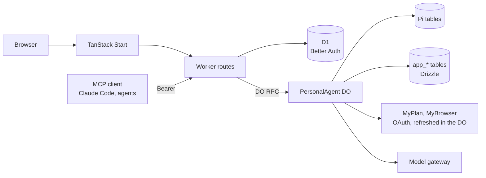

# Architecture

One Cloudflare Worker serves the web app and the API. Behind it, every user has their own `PersonalAgent` Durable
Object, named by their user ID: it runs Pi, holds that user's outbound MCP connections and credentials, and keeps
application state in its own SQLite. D1 holds Better Auth's account tables (users, sessions, inbound OAuth) and goblin's `app_billing_*` tables.



## Worker

`apps/web/src/worker.ts` sends pages to TanStack Start and the routes below to `apps/runtime/src/worker.ts`.
Runtime paths below are relative to `apps/runtime/src/`; browser paths are relative to `apps/web/src/`.

| Path | What happens |
| --- | --- |
| `/health` | Stage, service name, sign-up mode and whether mail is configured. |
| `/.well-known/oauth-protected-resource*` | Protected-resource metadata for `/mcp`. |
| `/.well-known/*`, `/api/auth/*` | Better Auth: sign-up and sign-in, the OAuth authorization server for inbound clients. |
| `/mcp` | goblin's own MCP server; a Bearer token from an inbound client reaches the agent of the user who consented. |
| `/api/*` | Owner API. A session cookie selects the signed-in user's agent; writes reject an `Origin` header if it names another origin. |
| `/hooks/mcp-events/<userId>/<token>` | Signed MCP Events; the user-bound route token is checked before object lookup. |
| `/hooks/myagent/<userId>/<token>` | Legacy Telegram doorbell fallback for servers without Events. |

## Accounts

Email OTP is the sole login method. A six-digit code expires after 600 seconds, permits five attempts and is stored
hashed in Better Auth's verification table. Sending is limited to one code per address per minute and ten sends per
IP per hour; sign-in permits twenty attempts per IP per five minutes. D1 holds rate limits because auth is created
per request. `GOBLIN_SIGNUP_MODE=open` admits new addresses; `invite` requires `GOBLIN_SIGNUP_INVITE_CODE` in the
`x-invite-code` header on both send and verify; `closed` permits only existing accounts. A successful OTP creates an
email-verified account or signs its owner in. Password, reset, verification-link and passkey endpoints are unavailable.

Every stage requires a mail sender. Deployed mail uses Cloudflare Email Sending from `hello@goblin.surf`; local
workerd captures `.eml` files through Alchemy's simulator. Better Auth 1.7.6 swallows mail callback errors, so a
request-scoped delivery flag and after hook erase an undelivered code and return 503. No account or session is created
by sending a code. The browser's OAuth provider client carries the authorization query through OTP login to consent.

The agent a request reaches derives from the session's user ID or the inbound token's subject. The Telegram hook
verifies a token bound to its user ID before selecting an agent. Deleting an account requires a sign-in from the last
600 seconds, with an explicit Settings confirmation. It first erases the user's agent through `Agent.destroy()`:
Pi, Agents and application tables, its alarm and isolate. Only then does Better Auth delete the user and D1 cascade
sessions, consents and tokens. Agent-erasure failure leaves the account intact for retry. Outbound OAuth tokens are
forgotten, not revoked remotely. Conversations, credentials, grants and resident authority belong to one user.

The owner API forwards to the agent object over DO RPC. Workers RPC drops custom error classes, so every DO method
returns an encoded `RpcResult`; the Worker decodes it and maps the tagged error to a status in one place
(`http/errors.ts`, `http/respond.ts`). Failures are logged as one JSON line with route, request ID, status and
error tag, never bodies or credentials.

## The agent object

`PersonalAgent extends Agent` and registers the native `PiHarness` with the Agent lifecycle. Pi owns transcripts,
tasks, submissions, recovery and tool replay. The object builds one Effect `ManagedRuntime` lazily, providing its
services: `Mcp` (the MCP host), `Resident` (resident authority), `Conversations` (the conversation registry),
`Budget`, `Models`, `Memory`, `Skills`, `Learner`, `Channel` and `Files` (`services.ts`). DO methods are thin: each runs one Effect
program and encodes the exit. PiHarness and Pi Durable are experimental; Alchemy is a pinned beta and Drizzle an RC. `@shadcn/react` is pinned at
0.3.1 and patched (`patches/shadcn-react/README.md`): its MessageScroller carries unreleased upstream fixes.

Conversations (`conversations.ts`): every agent has one **main** conversation, Pi's root session `1`, where the owner's
browser and every inbound MCP client talk. A message from anyone but the owner's browser starts with an author tag
block (`[from Claude Code]`, the `authorTag` contract), so the model and the web both know who wrote it. Side
**threads** are Pi conversations of their own: branched from a message of any open conversation (a Pi fork at that
entry, so the thread sees its parent up to there and the parent never sees the thread), at any depth, or empty under
main (ADR 0017). `app_conversations` registers each one as a tree (`parent_session`: where a thread branched from, a
subagent's spawner) with its kind, title, origin and close time; a session id reaches Pi only if it is registered
there, so no request opens a conversation by guessing its number. Pi cannot delete a conversation, so Close stops a
conversation and everything under it and keeps it readable until Reopen; main never closes. The web
lists them in the app's sidebar as a tree at any depth (`components/sidebar-tree.tsx` over the pure
`lib/workspace-tree.ts`): main with its subagents and theirs, then each thread with everything under it, closed ones
folded into "n closed" and settled subagents (idle, nothing at work under them, everything read, not in a pane, not
kept open; `settle`) into "n idle". Any row that started others has a chevron that folds them away, remembered per
owner in the browser, and a folded row counts the work under it; a thread nobody wrote in (a first send that failed) has no row unless it is in a pane, and an
App shows as a tile in its server's own hue. A row shows how long its agent has been working, a turning ring for work under it and a dot
for unread replies; a click shows it in the focused pane, its side button opens it beside, and it drags onto a pane
like a pane's grip. Folded on a desktop the sidebar is a 56px rail (`components/workspace-rail.tsx`) of main and the
active conversations, never hidden altogether, each with a hover card. Unread is the server's: `read_at` on
`app_conversations` is the owner's read mark, set when a pane has shown the conversation for a moment (half in view,
the page in front). Each conversation shows in a pane of its own (below); `/c/:id` names the focused one. Threads open inline first, at any depth (`components/inline-thread.tsx`): under the message a thread branched from
sits a chip with its reply count, name, last activity and state; it unfolds the live thread in place, set in under
the message by a rule at its left, with its own messages (the message it branched from is right above), its own
threads unfolding the same way, and a one-line composer, plus Open in pane to put it beside. While the thread is in a
pane the fold shows a note with the way to it and back. A message with no thread offers Reply in thread and Copy, in a
small pill over its lower edge where a pointer hovers, and on a touch screen once the message is tapped. Reply in
thread opens an inline reply that branches the
thread only when it is sent, because Pi cannot delete a conversation; the sidebar's "+" opens an empty draft pane the
same way. Panes and inline threads follow conversations through one stream pool (`lib/stream-pool.ts`): one event
stream per conversation however many show it, at most eight following beyond those on screen, and one off screen
stops following after ten seconds, resuming from a fresh snapshot when it comes back. A thread started with "+" tells
main its name once it has one (ADR 0010): main gets one `app.thread_started` note, `[thread started: "<title>"]`, and
its transcript shows a row for that thread. The owner API is conversation-scoped:

| Route | Purpose |
| --- | --- |
| `GET /api/workspace/events` | The workspace feed (SSE): a `WorkspaceSnapshot` of every conversation and kept App and what each conversation that is not idle is doing (`working`, `waiting` on subagents), then batches of `WorkspaceChange` (`workspace/feed.ts`, from Pi's task graph and the registries' writes). A tab skips any item or change it cannot read, so a newer server never stops it. |
| `POST /api/apps` | Keep the App of a call in a conversation (`{ conversation, callId }`): one made before Apps were kept, or one closed. The call must be an `mcp_call` whose tool still renders that App; the same call keeps the same App. |
| `GET /api/apps/:id/launch` | What loads an App (`AppLaunch`): an MCP App's server and `ui://` resource, and the call's arguments and redacted result read back from Pi; an agent app's view module, stylesheet, frame bundles and state. It grants nothing. |
| `PATCH /api/apps/:id` | Close or reopen an App (`{ closed }`). Closing a conversation closes its MCP Apps. |
| `GET /api/apps/:id/state` | An agent app's state now, with its revision and release (`AppSnapshot`). |
| `POST /api/apps/:id/call` | An action an agent app's view calls (`AppCall`: name, arguments, the frame's operation id). Answers the state after it, or the app's own error (`AppCallResult`). |
| `POST /api/apps/:id/diagnostics` | A failure an agent app's view reported (`AppDiagnostic`); kept with the app's events at most every ten seconds. |
| `GET /api/agent-apps/:name/powers` | The powers an agent app's running release asks for, each pending, approved or revoked (`AppPower`). |
| `PUT /api/agent-apps/:name/powers` | The owner approves or revokes one of them (`AppPowerChange`). Only the owner answers; the agent cannot. |
| `GET /api/conversations` | List registered conversations (`ConversationView`), closed ones included, each with its `parent`, where it branched (`forkEntry`), and its own `replies` and `lastReplyAt`, counted from Pi (`replies.ts`). |
| `POST /api/conversations` | Create an empty thread (`{}`) or branch an open conversation at an entry (`{ from: { conversation, entry } }`). |
| `PATCH /api/conversations/:id` | Rename, close or reopen (`closed`) a thread or subagent, or pin a subagent open (`keepOpen`). Closing stops it and everything under it; main cannot be changed this way. |
| `PUT /api/conversations/:id/read` | The owner has seen its newest reply: `read_at` moves forward to now, and the feed carries it as `readAt` (a later `lastReplyAt` is unread). |
| `GET /api/conversations/:id/capabilities` | What the conversation lets its agent use (`ConversationCapabilities`): each server with a granted tool and those tools, each skills library, subagents, and for a thread whether it has its parent's switches (`sameAsParent`). |
| `PATCH /api/conversations/:id/capabilities` | Switch one `CapabilityTarget` on or off there (only what is shown can be switched off), or `{ reset: 'parent' }` a thread back to its parent's switches. A subagent's are not editable. |
| `POST /api/conversations/:id/messages` | Submit `input`, a stable `operationId`, optional `appContext` and up to eight `attachments` (paths of the owner's files, each must exist) to an open conversation; returns 202 acceptance. |
| `GET /api/files?dir=` | A directory of the owner's files (`FileListing`): `/uploads`, `/agent` or a folder under one, with the storage in use. |
| `GET`, `PUT`, `DELETE /api/files/content?path=` | Download, write (the body, `content-length` required) or delete one of the owner's files. Downloads are attachments, except PNG, JPEG, GIF and WebP, which open in place; all are sandboxed by CSP. |
| `POST /api/conversations/:id/stop` | Stop a conversation or one `operationId`, and the subagents it started (not its threads). |
| `GET /api/conversations/:id/snapshot`, `GET /api/conversations/:id/events` | Pi snapshot or SSE snapshot followed by committed batches. |
| `GET /api/conversations/:id/history?before=<entry>` | Earlier entries, oldest first, with a `more` flag. |

Every thread runs the `goblin.thread` extension (`pi/thread.ts`), added to that conversation alone when it is made;
main never has it. It tells the model it is in a side thread and offers `share_back`: when the owner asks (the
thread's "Share to …" button sends that request), the model writes a short note into the conversation the thread
branched from as a Pi write submission, an `app.shared` entry labelled `[from thread "<title>"]` that keeps the
thread's id, so the label in that transcript opens the thread. The parent's model sees it from its next request and
answers nothing, since a write starts no run. A thread branched from a subagent is made a thread: it gets the host's
extensions and `ask_user`, without the subagent's own selection and instructions. After each response an untitled thread is named by the memory model
from its latest exchange, in the background; the owner can rename it. A thread started with "+" is created with
`app_conversations.main_note = 'owed'`; once it has a title (the model's or the owner's) the same hook writes main
an `app.thread_started` entry with request id `thread-started:<id>` and marks the note `written`. The note carries
only the name, never what was said in the thread, and a later rename does not rewrite it. Branched threads already
show under their message in main and get no note.

Main and threads can start **subagents** with the `subagent` tool (`pi/subagents.ts`, after Pi Durable's background
subagent example): `spawn`, `send`, `stop` and `status`. A subagent is a Pi conversation owned by a background anchor
task of its spawner, so the spawner's Stop and idle waits do not reach it. It starts with the spawner's model and is
given exactly the persona, the owner's MCP and budget extensions and the subagents extension again: the same grants,
subagents of its own at any depth, no `ask_user` and no skills (ADR 0018). Each message, the spawner's or the owner's,
goes through a relay task in the spawner (`pi/subagent-relay.ts`): it delivers the message, waits until the subagent is
done (idle, with none of its own relays live; it parks on those), then posts the newest answer once into the spawner as
an input labelled `[from subagent <name>]`, which the spawner answers. Request ids keep a restart from delivering or
reporting twice; of several messages on their way to one subagent only the last relay reports, quoting what the owner
wrote. The subagent then closes as done unless the owner wrote to it, branched from it or pinned it; a later message
from its spawner opens it again, while one the owner closed refuses its spawner. The owner's message to a subagent
pins it open and steers it when it is busy. Stop and Close stop the relays carrying to each subagent before aborting
it, so a job cut short reports nothing. The relay registers the subagent in `app_conversations` under its spawner, so
the web lists it there. In the spawner's transcript a spawn or send shows the subagent itself, live from the workspace
feed (`components/parts/subagent-block.tsx`, `lib/subagent-state.ts`): its state and clock, how many work under it,
and Stop (which asks first), Keep open, Dismiss or Reopen, opening to its task and its own subagents at any depth. A
report reads as "<name> reported back" with the report quoted, a subagent's pane opens with "Task from <spawner>", and
its composer steers it.

**Capabilities** (ADR 0010, `capabilities/`): each conversation can switch off, for its own agent, a connected server,
one granted tool of it, a skills library, or subagents. `app_conversation_capabilities` stores only what is off, so a
tool granted later is on everywhere. `CapabilityProfiles.scope(session)` is the one gate: a conversation's own switches,
and for a subagent those of every conversation above it, read live, at any depth (an unregistered session, or a broken
or cyclic chain of spawners, may use nothing). A thread copies the switches its parent works under as it is registered;
"Reset to where it came from" copies them again. What is off is hidden from the
model there: `mcp_list` leaves it out, the `skills` section does not list or fetch that library, and Pi's
per-conversation tool filter (`configure({ tools: { remove } })`) drops `subagent`, whose section then hides too. A call
that still arrives runs nothing: `mcp_call`, `skill_activate`, `skill_read` and `subagent` check the scope before
anything else (before the grant check or any connection) and return an error result with details
`{ kind: 'capability-off', target }` (`pi/capabilities.ts`), which the web turns into an owner-only "Turn on here"
card. In a subagent the result has words only. The owner's console and an App's own calls carry no conversation and
are not narrowed; Telegram and inbound clients talk in main, so main's switches cover them.

The persona contributes two static system-prompt sections (`pi/persona.ts`): who the agent is, and that remote content
is untrusted data. The `mcp_list` and `mcp_call` tools (`pi/resident-mcp.ts`) are how the model reaches the owner's
MCP servers; both require current resident authority, and `mcp_call` is marked unsafe to replay.

`ask_user` (`pi/ask-user.ts`) is how the agent asks the owner something. It takes one to five short questions:
single choice, multiple choice or free text. The tool result is the questions as numbered plain text, with details
`{ kind: 'question', questions }` (the `QuestionSpec` contract). It ends the run with `control: { terminate: true }`,
so no model call waits on a person. The answer is the owner's next ordinary message, whether it comes from the web
card or any other channel. A question counts as settled once a later user message exists.

The browser follows a conversation over Server-Sent Events: a snapshot of committed Pi entries, then batches, with
a heartbeat. On reconnect it starts again from a fresh snapshot.

Every signed-in page sits beside the app's sidebar (shadcn's sidebar, ported to `packages/ui`): the conversations,
then Connections, Settings and Sign out. Connections and Settings are columns of titled sections (`PageSection`)
whose states read in words (`lib/labels.ts`), never the raw value the runtime sends. On desktop the sidebar folds to an icon rail (the toggle in a page's top bar or the
first pane's pill, its edge, or ⌘/Ctrl+B) and a cookie remembers it, which the server reads so the first paint has the right layout; on
phones it is a sheet. The workspace fills the page beside it. The transcript scrolls in a `MessageScroller` (from `@shadcn/react`, patched with upstream fixes that are not
released yet; `bun run check:patches` proves the patch is installed). Each of
the owner's turns (typed in the app or sent from Telegram, `isOwnTurn` in `lib/parts.ts`) is a scroll anchor; a
message from an MCP client, a subagent, a routine or a thread's share-back arrives without moving the view. Until its
snapshot arrives a pane shows nothing, so a conversation opens at its end. A turn map in the transcript's right gutter
(`components/turn-map.tsx`) marks each of the owner's turns where it sits, with a band for what is on screen; hovering it
lists the turns and a click jumps to one. Without a fine pointer, or in a narrow window, an edge tab opens the list as a
bottom sheet. The view follows a streaming reply only while the reader is at the end, and
otherwise offers a jump back. The pane's pill (where it came from, its name and menu, its state) and the composer
float over the transcript as translucent chrome. Assistant Markdown is set by shadcn/typeset, whose append-stable rules keep earlier blocks still
while a reply streams.

Tool calls remain quiet expandable lines (`ToolCall` in `packages/ui`). Opening one shows labelled Input and Output
sections (`ToolPayload`), with the local `JsonView` adapted from MIT-licensed `mnove/json-view-cn`. The root opens,
nested branches fold, long strings expand on request, and each object or array shows 50 children at a time. The web
selector (`lib/tool-payload.ts`) reads the existing redacted MCP envelope: structured output first, then individual
content blocks, suppressing a duplicate JSON text block while keeping additional prose and non-text blocks as data.
Text that reads as Markdown opens Formatted (`lib/markdown.ts`), judged by the CommonMark and GFM grammar the renderer
parses: a table, two kinds of anchor (an ATX heading on its own line, a fenced code block, a table), or one anchor
among three kinds of signal. YAML and script comments, diffs, tracebacks and listings stay plain, because a missed
document is still readable and a false one would mangle data. `ToolMarkdown` sets it in the compact `typeset-tool`
preset as untrusted text: images are named and never loaded, only absolute http(s) and mailto links work and they
show their host, raw HTML shows as written and fences stay code. Reference definitions and link titles show only in
Raw. A long payload scrolls in place and fades at its bottom edge while more lies below (`scroll-edge-bottom`, driven
by its own scroll position). Ordinary or incomplete result text stays readable. Raw and its Copy action preserve the complete original text;
the tree copies complete values rather than its shortened display. No renderer fetches URLs or changes authority.

When the agent waits on the owner, the request is pinned above the composer until their next message
(`lib/interactions.ts`). This covers `ask_user` questions (a questionnaire) and grant-required results (an Allow card
for the exact server and tool). The reply is an ordinary message with a stable operation ID: `answer:<callId>` or
`grant:<callId>`. Allow first sets the exact grant through `PUT /api/mcp/grants`, and the allowed tool stays allowed.
In the transcript, both requests leave a quiet receipt. An Allow card is only trusted from goblin's own result for
the tool that was called, never from a remote result, which always carries `origin`.

The composer carries the agent's presence (`lib/presence.ts`): one state for the whole agent, with the most urgent
first. In order: offline, waiting for the owner, retrying, using a tool (named `server · tool`), writing, thinking,
budget spent, no answer, and ready. A small orb of moving colour (a Paper Shaders `MeshGradient`, loaded lazily)
shows it beside a text label, and its pace follows the work. While the agent waits on the owner, a pulsing border
frames the composer. Under reduced motion, in a hidden tab or before the shader loads, the orb is a still gradient and
the border is absent. Colours come from the theme's `--presence-*` tokens, resolved to RGB at runtime.

## Outbound MCP

Servers come from `GOBLIN_MCP_SERVERS` (JSON: `serverId`, `endpoint`, optional `issuer` and `resource`) and from
the owner, who may add up to sixteen by URL (`app_mcp_servers`, ADR 0006). An added endpoint is a public https
address (`mcp/endpoint.ts`), and its server card labels it as the server's own claim. Configured servers win on ID
and cannot be removed. Removing an added server forgets its row, endpoint binding, credentials, pending sign-ins and
grants in one transaction. Connections also offers a shelf of suggested servers (`mcp/suggested.ts`), with source
comments recording their connection checks. One tap adds and connects. It also searches MCP registries that speak
the generic registry API (`mcp/registry.ts`, `GET /api/mcp/catalog?q=`): the Official MCP Registry and GitHub's, built
in, then up to eight the owner adds (`app_mcp_registries`). A registry is
added only once it answers `/v0.1/servers`, and removing it keeps the servers added from it. Search reads one page of
up to twenty entries per registry and keeps https streamable-HTTP remotes, rejecting entries explicitly marked
inactive or not latest. Missing status metadata is accepted. Results are labelled by registry, each server once
(the official registry first), and cached for ten minutes. Endpoint placeholders are filled with one safe path
segment each, and servers that require a secret header are listed but cannot be added yet. An added entry records
its registry, name and version. The owner connects each server from the Connections page:

1. `POST /api/mcp/:id/connect` first tries without sign-in. If needed, it runs the MCP SDK's `auth()` with our
   `StoredOAuthProvider`: discovery, dynamic client registration, PKCE. Only a flow needing consent returns a remote
   authorization URL; otherwise it returns `{}`.
2. The remote server redirects to `/api/mcp/oauth/callback`. The pending state is single-use and expires after ten
   minutes; the code is exchanged and the tokens stored.
3. Client registration and tokens are AES-GCM encrypted at rest (`GOBLIN_CREDENTIAL_KEY`, bound to server ID and
   purpose); discovery metadata is stored in plain JSON.

Credentials and grants belong to the endpoint they were made for (`mcp/endpoints.ts`, `app_mcp_endpoints`). When the
agent starts and a server ID now points at another endpoint, everything stored for it is dropped in one short
transaction: credentials, client registration, pending authorizations and grants. The owner connects and grants
again, so tokens issued by one host never reach another.

Calls go through the `McpConnectionManager`, keyed by server ID, which caches a connection and closes it after five
minutes idle. Its auth provider refreshes a token a minute before expiry, single-flight per server, and refreshes
once after a 401. A refused refresh marks the server `needs_auth` and the owner reconnects. Results are bounded (1 MiB,
16 MiB for App HTML).

Grants are per discovered tool (`app_mcp_grants`), toggled by the owner. A tool grant also grants its `ui://` App
resource. An App's switch (`PUT /api/mcp/app-grants`, `McpHost.setAppGrant`) grants an App as a whole: exactly the
tools that declare its `ui://` resource, including the ones only the App may call, and the resource itself.
Connections (`components/tool-grants.tsx`) lists those tools under the switch, each still adjustable, and offers Allow
all and None, which send the same exact grants one at a time. Tool annotations from the server are shown as its claims
("says read-only") but never grant anything. Disconnecting forgets credentials and keeps grants. When the model calls a tool that exists but is
not granted, nothing runs. `mcp_call` returns an error result whose details are
`{ kind: 'grant-required', serverId, name }`, and the model is told to wait.
`mcpModelResult` details never carry a top-level `kind`, so remote content cannot forge one. The web turns that
result into an owner-only Allow card. A conversation can switch servers and tools off for its agent (Capabilities,
above); that check comes first, and switches are forgotten with the server's grants.

## Skills

Skills come from MCP servers that declare the MCP Skills extension, and only from those the owner turns them on for
in Connections (`app_skill_sources`, ADR 0008). The client declares the extension; `McpConnectionManager.listSkills`,
`getSkill` and `readSkillFile` speak `skills/list`, `skills/get` and `resources/read`, with the shapes decoded in
`skills/protocol.ts` because the SDK has no Skills support yet. The current library activates entries from
`skills/list`; `getSkill` is available in the connection manager.

`SkillLibrary` (`skills/library.ts`) keeps each enabled server's listing for its `ttlMs` (30 s to an hour) and names
every skill `<server>:<name>`. The `goblin.skills` extension (main and threads, not subagents) renders that list in
its `skills` section, refreshing an expired listing when the section is evaluated, and offers `skill_activate` and
`skill_read`. Activation reads `SKILL.md`, checks size, SHA-256 and frontmatter against the entry (`skills/verify.ts`),
and records the entry for the conversation (`app_skill_activations`). `skill_read` reads only files in that retained
manifest, so a conversation
stays on the version it activated. Verified bytes are cached by digest (`app_skill_files`) and checked again on every
read. A corrupted cache row is rejected and repaired by a verified refetch (local workerd regression evidence). A
local workerd restart preserves the activation manifest and cached bytes, then reads the same version without a network
call.
An unreachable server keeps its last listing while it remains cached in the isolate, or is reported unavailable.
Dynamic skills are declined; skill scripts can be read but are never executed (the only code goblin runs for the agent
is its own apps' and `code_run`'s, in Dynamic Workers; see Agent apps). Enabled skills are procedures the agent
follows, but they grant no permissions and cannot override the owner. Disabling the server stops new activations and
file reads; instructions already in a conversation stay there. A conversation can switch one library off for itself
(Capabilities): its section leaves the library out without fetching it, and its activations and reads are refused.

After a final answer (`onYield`), the learner (`skills/learner.ts`) looks at the latest user message. On a correction
or a request to keep how something was done, the memory model decides whether the exchange teaches a procedure. A
procedure becomes a draft sent through an enabled library's granted `skill_draft` tool, which the owner reviews in the
library. The Worker logs the learner outcome and conversation id without transcript or draft content. At most five in a rolling 24 hours, never the same content twice, no new draft while one for that skill is open,
and never a rejected draft again (`app_skill_drafts`). A grant for `skill_draft_status` lets the learner refresh review
status; a deterministic workerd test confirms a rejected draft is not submitted again for the same lesson. Draft
payloads contain generated procedure text and brief evidence, with email- and secret-shaped strings
scrubbed, and no transcript field. The learner's model call counts toward the budget.

## Chat blocks

The agent's replies draw three kinds of fenced block (ADR 0023): ```mermaid diagrams, and ```chart and ```map with a
JSON spec (`ChartSpec`, `MapSpec` in `packages/kit/src/specs.ts`). `MessageText` (`components/parts/text-part.tsx`)
hands such a block to `RichBlock` (`components/parts/blocks.tsx`), which loads that kind's module from `@goblin/kit`
on first use and shows the plain code block whenever the source does not parse or drawing fails. While a reply
streams, the block whose fence is still open stays code (`lib/fences.ts`). A diagram is beautiful-mermaid's SVG as an
`` data URI with the theme's tokens resolved to concrete colours, so nothing in it runs or loads; it redraws when
the theme changes. Charts are Recharts in the five `--chart-*` tokens; maps are Leaflet over OpenStreetMap's
raster tiles, quieted to the theme by a CSS filter, the one host a block fetches from. The persona tells the model the
three shapes; Telegram shows them as code.

## MCP Apps host

An App is a tool's `ui://` resource, served by the server that answered the call. It runs in two nested opaque
sandboxed frames (`lib/app-sandbox.ts`). The outer proxy only relays protocol messages to and from the host's origin.
Its calls go through the owner API to the originating server and need that server's grant.

Every conversation, a thread's draft and every App's page is a pane of its own (ADR 0019). The pane store
(`lib/workspace.ts`) holds a Trellis document of one-view panes keyed by item (`c:<id>`, `d:…`, `a:<id>`), the focused
item and an optional filled pane; `components/workspace.tsx` provides it to the whole app so the sidebar and every
transcript link can open things, and keeps the URL (`/c/<id>` or `/a/<id>`) on the focused item. At 75rem and wider
`components/workspace-surface.tsx` mounts Trellis 0.3.0 after hydration as a controlled layout (no tabs, menus,
floating, navigation or shortcuts) inside a sideways scroller about 400px a pane wide; narrower screens show one pane
per screen in a snapping strip whose pane in view is the focused one. Each item renders once into a stable portal host
that moves between panes, the strip and a parking lot, so streams and React state survive rearrangement. Each pane
draws its own floating pill (`components/pane-header.tsx`): a mark of what it holds (main, a thread, a subagent's
state, an App's tile), where it came from, its name and menu, and its state; the menu starts with its path and the
conversations around it to show in that pane instead (`components/pane-nav.tsx`). `components/workspace-drag.tsx` drags a pill's grip onto a
pane to split it at an edge or swap with it (`lib/pane-drop.ts`). The arrangement is a bounded device preference
(`goblin:workspace:v2:<owner>`, 64 views, no stage, nothing floating); conversation and App panes come back from it,
drafts do not. The sidebar footer credits Trellis and Dan Fessler; see
[ADR 0016](adr/0016-workspace-layout-with-trellis.md) for the license arrangement.

Apps are kept (ADR 0020). A call the owner's agent makes to a tool that declares an App keeps it in the agent's
registry (`apps/registry.ts`, `app_registry`, one per conversation and call); *Show app* on an older or closed one keeps it
through `POST /api/apps`. The workspace feed lists them, the sidebar shows each under its conversation (numbered when
one title repeats, all but those open as pages and the newest three folded), and closing a conversation closes its
Apps. `GET /api/apps/:id/launch` reads the call's arguments and redacted result back from the
transcript; keeping and launching grant nothing.

Several Apps run at once, in any conversation the owner views (`components/apps`). `AppHost` holds one instance per
loaded App, and `AppLayer` draws one fixed stage per instance outside the panes, never moved in the DOM, so nothing
reparents an opaque frame or replaces its bridge. A stage follows its App's page while the App has one, else its place
under its tool row (`app-inline:<id>`, `app-page:<id>` slots), frame by frame, including while panes scroll, and
springs between the two (`lib/spring.ts`). It clips itself to the containers that scroll its slot and to the band of
the pane's pill and its composer (`data-app-cover`, `lib/app-occlusion.ts`), which also keeps pointer events off what is
hidden; text fades out under the same chrome through a mask on the transcript. An App
loads when its place comes on screen; beyond six instances the least recently seen unloads to a stub
(`lib/app-residency.ts`), while one on screen never does. The advertised modes are inline and fullscreen: fullscreen is
the App's page filling the workspace (Open as a page, then Fill the workspace), and on a phone the page is a pane in
the strip. In its transcript the host's bar above an App opens its page or closes it; on its page the pane's pill
menu brings it back, fills the workspace or closes it. Grant cards, link offers and context sharing remain
host-drawn, per App.

The App learns the host context (`lib/host-context.ts`): theme, our tokens as MCP Apps style variables, device,
locale and time zone, its display mode, the modes on offer, and its measured box. The host re-sends it when these change.
On its page the App fills the pane; in its transcript its own height request is bounded (160px to 70% of the window).

Two more requests are drawn by the host, where the App cannot reach (`lib/app-context.ts`). A link the App asks to
open (https only, no credentials) becomes an offer with a real anchor, so only the owner's click opens it. Context
the App shares for the agent (`ui/update-model-context`, text or structured content rendered as JSON, at most 8192
JavaScript string units) waits in a removable chip above its conversation's composer and travels once, with the
owner's next message there, as `appContext` on `POST /api/conversations/:id/messages`. The runtime (`pi/content.ts`)
appends it after the owner's words as a separate block shaped `{ origin: { serverId, trust: 'untrusted' }, appContext }`.
The persona treats it as data, never as the owner speaking, and the transcript shows it as a note under their message.

An App's own call to a tool the owner has not granted does not fail at once (`components/apps/grant-ask.tsx`). It
waits on a card the host draws in the App's chrome, naming the exact tool. Allow grants that one tool and runs the
same call again. "Not now", or two minutes without an answer, returns the denial to the App.

## Agent apps

The agent builds apps for the owner (ADR 0021): small programs with durable JSON state whose actions and views become
its tools. `app_build` takes an app's files (`app.ts`, up to five more, TypeScript, importing only `@goblin/app` and
each other); `agent-apps/build.ts` transpiles them with sucrase in the toolchain's own Dynamic Worker, runs the
release's `describe()` in the release's isolate, checks the manifest (`agent-apps/manifest.ts`: names, schemas of the
`s.*` subset, `initial` fitting `state.schema`), and on an upgrade keeps the state when it fits the new schema or
runs `state.migrate`. Only then does the release become active, as one transaction (`agent-apps/store.ts`); a failed
build is kept with its problems and changes nothing that runs. Every app release, the transpiler and `code_run` run
through `agent-apps/isolates.ts` over the `LOADER` binding: no network, no bindings, a CPU limit, at most eight calls
at once, and wall timeouts.

A call (`agent-apps/dispatch.ts`) checks its input against the member's schema; an action's `prepare` runs once
with a read-only state snapshot and the app's powers (its own files in Shell's namespace `app_<name>`, a log line),
then in the app's queue `run` reads the current state and returns the next, which is checked and committed as one
revision with the operation's receipt. A replayed operation id returns its receipt. Each app is one Pi extension,
`goblin.app.<name>`, with a tool per action and view (`app_<name>__<member>`, `agent-apps/toolset.ts`); the harness
selects them for main and threads through a getter (`pi/harness.ts`), so a new or changed app is offered from the
next model request, and the agent object installs them before Pi opens, so a restarted agent offers them at once. A
call pins the release it began on (`goblin.release` memo) and refuses to run on newer code. Subagents and routine runs
set their own exact extension lists and get no app tools. `goblin.apps` (`pi/apps.ts`) offers `app_docs`, `app_build`,
`app_inspect`, `app_rollback` and `code_run`, and lists the apps in the prompt. The SDK, release entry, transpiler and
docs are `packages/app`, built into `dist/toolchain.js` (loaded only while building). The owner deletes apps and
sees them outside the transcript in a later milestone.

An app with a `view.tsx` has a UI (`packages/app/docs/ui.md`). The transpiler makes the view one CommonJS module with
React's automatic JSX runtime and refuses imports the frame does not provide; the style compiler (Tailwind's, with
goblin's theme, in its own Dynamic Worker) compiles exactly the classes the view uses. Both are kept per release
(`app_agent_views`). The first release with a view adds the app to the App registry under its home conversation
(`apps/registry.ts`), and every revision after that reaches the workspace feed. The web host loads it like an MCP App,
in the same double sandbox (`lib/app-sandbox.ts`): a document of goblin's stylesheets, the app's own, and its module,
over the frame bundles from `packages/app/dist/runtime` (React, the UI SDK and goblin's components in `core.js`;
charts, maps, diagrams and icons only when the view imports them), served as hashed assets. The frame has no network
(`connect-src 'none'`); it loads scripts from goblin's origin only, and tiles from OpenStreetMap only for maps. The
bridge (`lib/agent-app-bridge.ts`) sends the state as tool results carrying `goblin/state` (the newest revision wins),
routes the view's action calls to `POST /api/apps/:id/call` with the frame's operation id (`ui:<app>:<uuid>`), and
reports the view's failures, which the agent sees in its apps section and in `app_inspect`. A new release reloads the
frame; a new revision is pushed into it. In the transcript the view shows under the newest build of it with one.

Beyond its state and files, an app reaches only the powers it declares and the owner approves (ADR 0021):
`ctx.fetch` to exact `egress` hosts (`agent-apps/egress.ts`: https on 443, never goblin's own domain, redirects checked
again, no cookies, bounded), and through the agent (`agent-apps/ports.ts`, connected in `compose.ts`) the owner's MCP
tools under their exact grants, the cheap model within the owner's budget, Telegram through their channel, and other
apps' actions and views (`agent-apps/engine.ts` composes each `prepare`'s `AppPowers`). Every use checks the approval
(`app_agent_powers`), the app's daily cap (`app_agent_usage`) and, for what goes through the agent, the owner's plan
and resident authority. A build lists the powers still waiting; the web draws them as a card under it
(`components/parts/app-powers.tsx`). A view offers files to save through the host's download offer. The agent looks
for MCP servers with `mcp_suggest` and asks the owner to add one with `mcp_request_server` (`pi/servers.ts`), a card
whose Add and connect runs the usual flow.

An app's `schedules` run its actions on their own (`agent-apps/jobs.ts`): one `app_agent_jobs` row and one dated
native schedule (`runAppJob`) per scheduled action, reconciled when a release activates or rolls back and when the
agent object starts. A job is an ordinary call with its own operation id; it catches up only the newest missed slot,
backs off after failures and pauses after ten, and waits while resident authority lapses. Each app's schedules ride
the workspace feed (`AgentAppSource.jobs`) to the App's bar.

## Files

The owner's files (ADR 0022, `files/store.ts`): `@cloudflare/shell`'s Workspace over the agent's SQLite, with files
over 128 KiB in the stage's R2 bucket under `agents/<userId>/`. `/uploads` holds what the owner uploaded; `/agent` is
where the agent writes. The owner reads and writes both through `/api/files`; the agent reads both and writes only
`/agent`, with `files_list`, `files_read` (text, 48 KB a page), `files_write` and `files_delete` (`pi/files.ts`, the
`goblin.files` extension, on main and threads; subagents and routine runs keep the tools they are handed). Limits: 25 MiB a file, 512 MiB and 2,000 files in all, checked before
each write; a body longer than it declared stores nothing. The composer's paperclip uploads to
`/uploads/<local date>/` under a name that replaces nothing (`lib/files.ts`), and the message carries the paths: Pi
gets the owner's words, then one block listing each file's path, name, size and type, then any App context
(`pi/content.ts`). The web reads that block back into chips under the message (`lib/app-context.ts`), only when every
block after the words is one it knows. Deleting the account deletes the R2 prefix before the object's storage.

## Main's memory

Main never ends, so it keeps a memory instead of an ever-longer context (`memory/`, after VictorTaelin's OptChat
gist). Every message of main since the memory was activated is logged in `app_memory_log` with its Pi entry id:

- the owner's and other authors' words, notes shared from threads, and the notes naming threads started with "+";
- the agent's replies, with their tool calls;
- tool results.

System entries and thinking are never logged. Memory text keeps at most 12 000 JavaScript string units from each
message's head and tail, plus a truncation note (`memory/log.ts`); Pi retains the original entry. This also bounds a
single-message `zoom`.

A background builder task (`pi/memory.ts`), which main starts after each of its responses, summarizes each message in
order into one line of about 512 bytes with the memory model. It then merges adjacent lines in pairs into a binary
tree (`app_memory_nodes`). A short message, or a pair that fits, is its own line word for word, with no model call.
The view folds the tree toward 48 000 bytes (`memory/tree.ts`): one line per recent message, and older lines covering
more messages, merging the pair that is oldest relative to its size first. Only the merges the view needs are built.

The builder writes the view into main as an `app.memory` entry, a Pi write submission whose head is main's newest
input, which is how Pi places a compaction. The model then sees the view and, verbatim, everything from that input
on, so nothing waits for the summarizer. `zoom(id, n)` (the `goblin.recall` extension) opens a line into the two
under it, down to a single message. It is offered in main and in threads branched from it; a branched thread is
bounded at its fork.

The summarizer's tokens count toward the budget, and the builder stops once the budget is spent. The memory begins at
activation: older history stays in Pi, out of the model's context once the first view lands. Once a view or a
compaction starts a conversation's snapshot later, the web reads the earlier entries through
`GET /api/conversations/:id/history?before=<entry>`; it never shows the marker entries themselves. Settings shows how many
messages main remembers.

## Models

Each user picks the model their agent answers with, in the composer. The deployment offers `GOBLIN_MODEL_ID` (the
default) plus `GOBLIN_MODELS`, all served by the same LiteLLM key; `models.ts` names and groups them by route
(Google, Alibaba Cloud), because quota runs out per route. The pick is one row in `app_model_choice`; without one, or
when the deployment stops offering it, the default applies. Pi stores one model per conversation, set when it is
created, so before each turn the agent calls `session.setModel` for the conversation the turn runs in, skipping it
when that conversation already has the model. Every offered model is registered with
Pi's `Models` under the one `goblin-litellm` provider. A failed model call shows its reason in the chat, and a
quota or outage failure points at the picker.

Housekeeping (thread titles, main's summaries and skill-draft decisions) runs on `GOBLIN_MEMORY_MODEL`. Set it to a
cheap offered model; the code does not choose by price. Unset or not offered, it falls back to the default
(`models.ts`, `memory/model.ts`). Its tokens count toward the owner's daily budget like any other.

## Model budget

Users share the deployment's model key, so each agent has a daily token budget (`GOBLIN_MODEL_DAILY_TOKENS`,
default 300 000, per UTC day). A Pi extension (`pi/budget.ts`) records every model response's tokens in
`app_usage_daily`. Once the day is spent, new turns are refused with `BudgetExhausted`: HTTP 429 from the owner API,
or a tool error from `/mcp`. Telegram submissions check the same budget. Tool calls inside a running turn are blocked,
so a looping turn ends after one more reply. Pi reports and swallows exceptions thrown by hooks, so the in-turn lever
is blocking tools, not throwing. Settings shows today's usage, and the composer shows it as a ring, re-read whenever
a run ends. On wider screens the composer also
shows how full the context was at the latest response, measured against the model's `contextWindow`. The model key's
own cap stays the backstop.

## Resident authority

The agent acts for the owner when the owner is not there, so it needs its own standing permission rather than a
borrowed browser session. `ResidentAuthority` (`app_resident`) is active for 30 days. Owner RPC calls renew the window;
inbound calls and hooks do not. Turning it off in Settings ("Work while you're away") sticks: activity does not
re-enable it, only the explicit toggle does. Model MCP tools, skills, inbound `ask_agent` and scheduled Telegram pulls and replies require current authority.
Owner MCP RPC methods renew it but do not call `requireResident`; their tool/resource calls still check exact grants
(`agent.ts`, `pi/resident-mcp.ts`, `pi/skills.ts`).

## Inbound MCP

goblin is an MCP server at `/mcp`, the protected resource of Better Auth's `mcp()` authorization server:

- Clients register dynamically (open, but restricted to the `/mcp` resource). A registration whose redirects are
  all http loopback is marked native, which is how Claude Code registers.
- The owner signs in and consents at `/consent`. A Bearer token is accepted only if it verifies against the local
  JWKS, names `/mcp` as audience, comes from an enabled client and the owner's consent still exists.
- Tools: `ask_agent` (submit into main, labelled with the client's name, and wait up to 110 seconds; a stable
  `operationId` makes it idempotent) and `get_recent_messages` (main's latest messages, with their authors).
- Revoking a client in Settings deletes the consent, disables the client and revokes its refresh tokens; its next
  call gets a 401.

## MCP Events and Telegram

The owner selects one Telegram connection with its **Telegram** switch (ADR 0011). If its authenticated discovery
advertises top-level `capabilities.events`, the action grants `inbox`, `send_message` and the exact Events selectors
`message.received` and `question.answered` with `{}` arguments. Both finite webhook subscriptions must confirm before
`app_telegram_channel` copies the checkpoint and fences old doorbell cursor writes. The channel pulls immediately;
a failure before that fence leaves the old channel checkpoint intact. A server without Events retains the legacy
`subscribe`/`unsubscribe` doorbell transport. Connections shows the active transport.

`POST /hooks/mcp-events/<userId>/<token>` verifies the user-bound token before lookup. Inside the object, Standard
Webhooks HMAC and five-minute freshness checks precede decoding. A pre-persisted subscribe intent accepts an early
signed verification challenge; remote ids are cross-checked when subscribe returns. Receipts and their frozen consumer
revisions commit in short transactions, with an already armed recovery schedule. The hook returns quickly and dispatch
runs asynchronously. Replay wakes unfinished handlers without duplicating their accepted intent.

`message.received` and `question.answered` both pull the authoritative inbox into main. `ask_user` ends its turn;
the answer arrives as the owner's next inbox message. The existing id mapping is preserved: `tg:123` becomes
`telegram-tg-123`, and reply operations keep their sanitization/truncation. Main's replies and subagent reports go
back with `send_message`, escaped and chunked, using `app_channel_replies`. Submission acceptance is distinct from
external Telegram completion. Disabling cleans up Events while authority is available, then tombstones locally;
finite remote leases expire if authorized cleanup cannot run.

The dispatcher also binds MySkills `skills.updated` and `skills.list_changed`. Their payload is untrusted metadata;
the handler persists a dirty catalog generation and invalidates the cache before acknowledgement. A listing can
clear only the generation it observed, and retained activations stay pinned. Gap controls trigger reconciliation;
termination stops lease refresh and surfaces health. Mail and workspace changes have no installed consumer yet.

The client refreshes before the producer's ISO `refreshBefore` and polls on gaps or webhook outages. Bounds are
32 subscriptions, 100 events per page, 256 KiB bodies, five-second remote requests and 10,000 pending rows / 32 MiB.
Recovery sweeps process at most 256 deliveries and retain completed receipts for eight days; unfinished receipts
are never pruned. Workers cannot pin resolved DNS IPs; trusted DNS is the documented v1 deviation (ADR 0011).

## Storage

| Store | Tables | Owner |
| --- | --- | --- |
| Agent DO SQLite | `pi_*`, `cf_agents_*` and the other vendor tables | Pi, Agents SDK. Never touched. |
| Agent DO SQLite | `app_mcp_servers`, `app_mcp_registries`, `app_mcp_endpoints`, `app_mcp_credentials`, `app_mcp_oauth_pending`, `app_mcp_grants` | Drizzle: MCP metadata and authorization. |
| Agent DO SQLite | `app_resident`, `app_conversations`, `app_model_choice`, `app_usage_daily`, `app_metadata` | Drizzle: agent metadata. |
| Agent DO SQLite | `app_conversation_capabilities` | Drizzle: what each conversation switched off (ADR 0010). |
| Agent DO SQLite | `app_memory_log`, `app_memory_nodes`, `app_memory_state` | Drizzle: main's memory. |
| Agent DO SQLite | `app_skill_sources`, `app_skill_activations`, `app_skill_files`, `app_skill_drafts` | Drizzle: skills and draft tracking. |
| Agent DO SQLite | `app_channel`, `app_telegram_channel`, `app_channel_replies` | Drizzle: Telegram transport checkpoints and replies. |
| Agent DO SQLite | `app_mcp_event_grants`, `app_mcp_event_subscriptions`, `app_event_deliveries`, `app_mcp_event_consumers`, `app_event_consumer_receipts` | Drizzle: exact Events grants, leases, encrypted receipts and independent acknowledgements. |
| Agent DO SQLite | `app_skill_catalog_state` | Drizzle: durable catalog invalidation generations. |
| Agent DO SQLite | `cf_workspace_files` | `@cloudflare/shell`'s Workspace: the owner's files (ADR 0022), vendor-owned like `pi_*`. |
| R2 `files` | `agents/<userId>/files/…`, `agents/<userId>/app_<name>/…` | Shell: the owner's and each app's files over 128 KiB. Deleting the account empties the prefix. |
| Agent DO SQLite | `app_agent_apps`, `app_agent_releases`, `app_agent_artifacts`, `app_agent_views`, `app_agent_state`, `app_agent_snapshots`, `app_agent_receipts`, `app_agent_events`, `app_agent_powers`, `app_agent_usage`, `app_agent_jobs` | Drizzle: agent apps, their releases, code and views, state and revisions, rollback snapshots, receipts, events, the owner's answers to their powers, their daily usage and their schedules (ADR 0021). |
| Agent DO SQLite | `cf_workspace_app_<name>` | Shell: each agent app's own files. |
| Agent DO SQLite | `app_registry` | Drizzle: every App the workspace shows, by source: an MCP App per conversation and call, an agent app per name (ADR 0020, 0021). `app_apps`, its predecessor, was copied in with the same ids and is no longer read. |
| D1 `goblinAuth` | `user`, `session`, `account`, `verification`, `jwks`, `rateLimit`, `oauth*` | Better Auth, `apps/runtime/migrations`. |
| D1 `goblinAuth` | `app_billing_accounts`, `app_billing_subscriptions`, `app_billing_inbox`, `app_billing_checkouts` | Drizzle: account payments and durable reconciliation. |

The withdrawn Members feature left dormant auth D1 tables and DO columns/tables. Applied migration files and keys
remain intact to preserve real data and migration history; the runtime no longer reads or writes that access metadata.
See [ADR 0014](adr/0014-members-and-workspace-authority.md) for the withdrawal.

Application tables are declared in `storage/schema.ts` and migrated inline in `storage/migrations.ts`.
`app_client_sessions` was dropped when inbound clients moved to main; it is not a current table.

Better Auth lives in D1 because the Durable SQLite adapter's async transactions and affected-row semantics do not
meet its contract (ADR 0001). SQLite transactions are short and never span model or network calls.

## Infrastructure

`apps/web/alchemy.run.ts` declares the Vite Worker, the `PersonalAgent` namespace, the D1 database, the `FILES` R2
bucket and the `LOADER` Worker Loader (Dynamic Workers, open beta, Workers Paid); it is the only deployment
entrypoint. `scripts/stage.ts` builds `packages/app`'s toolchain before Alchemy runs. The local stage runs in workerd with CLIProxy; the dev stage calls Railway LiteLLM with a
dedicated model-limited, budget-capped key. Offered models and price weights come from stage configuration; the per-account allowance comes from its plan or
operator override. The key's provider caps and shared quotas are managed outside this repository; source does not prove
their active values. Secrets are Worker secret bindings, never in the browser bundle.


## Stage origins

Dev runs at `https://dev.goblin.surf`; the apex is reserved for future production. The fresh Goblin stack creates
`goblin-dev-auth`, an empty native Agent namespace and new auth/encryption secrets. It imports no users, transcripts,
connections or grants. Production will use separate resources and secrets. `GOBLIN_DOMAIN` and `GOBLIN_ZONE_ID` attach
the stage's custom domain; prod additionally has a `www` alias. Both Worker entry points redirect alternate origins
before auth, hooks or rendering: 301 for GET/HEAD, 308 otherwise, preserving path/query with `APP_URL` as authority.
Auth trusted origins and inbound MCP metadata derive from that origin. Dev mail subjects include its host; prod
subjects have no prefix. Domain reachability and actual OTP delivery require separate live checks.

The inbound Agents SDK handler explicitly allows only the configured `APP_URL` hostname for both Host and browser
Origin validation. The SDK defaults otherwise reject browser requests on custom domains. A native workerd regression
proves a custom-domain Origin succeeds and a foreign Origin is rejected.

## Plans and payments

The account boundary in auth D1 is independent of the agent's Pi store (ADR 0015). `billing/` owns customers,
subscriptions, checkout rate accounting and the verified webhook inbox through Drizzle `app_billing_*` tables. Better
Auth continues to own identity and inbound OAuth. No billing operation writes Pi or Agents tables.

`GET /api/billing/state`, `POST /api/billing/checkout` and `POST /api/billing/portal` authenticate the owner without
resolving an Agent. Product and checkout metadata are selected server-side. Checkout and the return page grant no
access: `POST /hooks/dodo` verifies Standard Webhooks HMAC over the raw body, checks freshness and stores the first
body under `webhook-id` before responding 2xx. A leased background run updates the subscription; an hourly Worker cron
retries unfinished receipts and reads stale subscriptions back from Dodo. Provider timestamps prevent old events
from overwriting newer states. This is durable idempotent reconciliation, not exactly-once provider effects.

Worker APIs, inbound MCP and user-bound hooks require an active plan before selecting the user's Agent. Agent owner,
client and background runs also check the shared `Entitlements` service. It reads current account state at admission,
without a cached plan or a lifecycle lock around D1/network waits. Pro is $10/month, without trial or free tier; active
or cancelled subscriptions remain usable only through their recorded paid period. Failed renewals use the provider's
grace end or three days after the period end; missing dates fail closed. Existing users at the billing migration get a
dev-only override, which grants nothing on prod. Operator overrides may supply their own allowance.

Each Agent's usage ledger still records its owner's UTC-day spend, while the allowance now comes from that account's
plan (2M/day for Pro). Optional configured model price multipliers count weighted tokens in Pi replies and cheap
memory/title calls, with weight one for omitted models. The price schedule needs operator review.

The browser reads billing state before mounting agent pages; unpaid accounts reach `/subscribe`. The return page
polls verified state and Settings opens the Dodo portal. `/terms`, `/privacy` and `/refunds` are draft public pages,
pending operator identity and legal review. Native workerd tests verify signup, injected checkout, activation,
replay, stale updates, cancellation, grace and per-account allowances with real D1/Agent storage. They do not prove
live Dodo delivery or merchant onboarding.

## Isolated memory experiments

The [benchmark workspace](../bench/README.md) replays private, redacted Claude and Hermes histories through native Pi write
submissions in its own local workerd actors. OptChat, native compaction and lexical archive search share fixed source
cutoffs and bounded API/retrieval allowances. Source tool calls are transcript evidence; the benchmark installs only
recall/search tools and never executes historical commands. Expected claims stay on the coordinator host, outside
worker requests. Private manifests, source hashes, API ledgers, native contexts and identity-bound semantic reviews
make runs inspectable. Recall v2 compares the four memory/search combinations with a coupled DeepSeek writer and
reader, enforces phase and cutoff allowances, and requires a durable operational receipt before the later cutoff.
Blinded packets preserve unmodified answers; separate machine/human votes and adjudication provide semantic scores
alongside strict format/evidence results. Shared construction is charged once per memory. This local recall
experiment does not mutate a deployed user's agent or prove coding continuation.

The overnight coordinator binds multiple frozen corpora and monotonically extended memory artifacts to one durable
budget covering native preflight, construction, answers, independent machine review and retries. Native replay uses
bounded closed tool exchanges; search pairs reuse checkpoints, while probe forks isolate generated answers. Build
receipts distinguish cold, extended and reused work. Blinded Muse findings remain diagnostic until independent human
review; real source checkpoints and explicit product criteria do not authorize production promotion.

## Routine definitions

`routines/store.ts` stores bounded drafts and immutable operation receipts in application SQLite. A model can propose,
list or pause through `routine`; only an authenticated owner may confirm the exact revision. Routine writes require
an exact configured Origin and `x-goblin-csrf: 1`. Edits clear confirmation and stale revisions return 409. Settings
shows the prompt, exact tool pairs, timezone, budgets and Telegram policy before confirmation.

Confirmed reminders and cron schedules use native dated Agent callbacks carrying routine ID, revision and firing
instant. A short application transaction claims each firing and advances its watermark before rearming; one newest
catch-up replaces missed slots, with a 24-hour window and one encrypted pending trigger while busy. Reconciliation
repairs missing schedules and removes only routine-owned wakes. The earliest-wake check considers future jobs only:
Agents includes the currently firing row in `listSchedules`, and counting it would suppress the next report/recovery
sweep. UTC reminders require an explicit offset. The
numeric cron parser enforces 15-minute spacing, skips spring DST gaps and chooses the earlier autumn repeated instant.

Pi background Anchor/Reporter tasks create and recover an empty task-owned run conversation, registered as a thread
without copied capability rows or an ordinary main-start note. The confirmed MCP ceiling narrows `Capabilities.scope`.
A dedicated per-run model provider checks resident authority, entitlements, deadlines and committed usage before
every model dispatch, including compaction. MCP checks repeat at the HTTP dispatch seam after token refresh, with
local correlation headers removed before egress. Main Stop leaves background runs alone; run Stop and archive fence
and abort owned conversations. Questions use sealed shared interaction receipts and authenticated same-session answers.

Committed `pi.usage` counters, including compaction, project into app-only cumulative watermarks and weighted UTC-day
receipts. Replay does not charge twice; a model response already in flight may overshoot a cap. Settlement freezes a
scrubbed summary and one `app.routine` parent write with a stable request ID. Telegram reporting is separate authorized
plumbing with frozen bytes/server, stable operation ID, five bounded attempts over at most 15 minutes, and a separate
remote acceptance receipt. Pi acceptance does not establish external delivery. Additive migrations …210/…211/…212 modify
only application tables.

Event confirmation grants the exact connected server/name/canonical-arguments selector after authenticated review;
its arguments must satisfy the producer descriptor schema. `routines/events.ts` binds `routine:<id>` and the current
revision to ADR 0011's static dispatcher. Shared leases survive until their last consumer retires. Each admitted
occurrence claims a losslessly escaped event ID, seals scrubbed bounded metadata, and labels it as untrusted data
in the fresh run input. Replays remain no-ops across revised consumers, even after ingress receipts expire. At most
one event run per minute is admitted across the agent; busy or spacing conflicts replace one sealed pending firing,
whose durable handoff and consumer acknowledgment commit together. Gap controls show recovery health and use the
originating authoritative poll; verification and termination create no model turn. Termination pauses the routine
and requires owner reconfirmation. Pause/edit/archive retire the consumer; pause advances an Event revision so a
retired receipt cannot become live again. Local signed-fixture proof is separate from real producer acceptance. See
[ADR 0012](adr/0012-routines.md).
