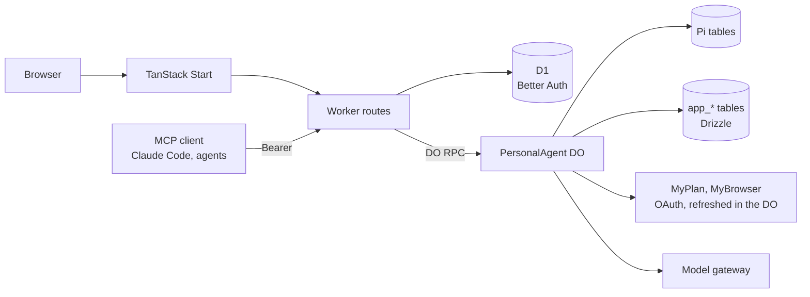

# Architecture

One Cloudflare Worker serves the web app and the API. Behind it, one `PersonalAgent` Durable Object per owner is the
resident agent: it runs Pi, holds the outbound MCP connections and their credentials, and keeps application state in
its own SQLite. D1 holds Better Auth's tables only.

## Worker

`apps/runtime/src/worker.ts` routes every request:

| Path | What happens |
| --- | --- |
| `/health` | Stage and service name. |
| `/.well-known/oauth-protected-resource*` | Protected-resource metadata for `/mcp`. |
| `/.well-known/*`, `/api/auth/*` | Better Auth: owner sign-in, the OAuth authorization server for inbound clients. |
| `/mcp` | Purrable's own MCP server; needs a Bearer token from an inbound client the owner consented to. |
| `/api/*` | Owner API. Requires the owner's session cookie; writes also require the app's own `Origin`. |

The owner API forwards to the agent object over DO RPC. Workers RPC drops custom error classes, so every DO method
returns an encoded `RpcResult`; the Worker decodes it and maps the tagged error to a status in one place
(`http/errors.ts`, `http/respond.ts`). Failures are logged as one JSON line with route, request ID, status and
error tag, never bodies or credentials.

## The agent object

`PersonalAgent extends Agent` and registers the native `PiHarness` with the Agent lifecycle. Pi owns transcripts,
tasks, submissions, recovery and tool replay. The object builds one Effect `ManagedRuntime` lazily, providing three
services: `Mcp` (the MCP host), `Resident` (resident authority) and `Sessions` (inbound client sessions). DO methods
are thin: each runs one Effect program and encodes the exit.

Conversations: the owner's browser uses Pi's root session (the main thread). Each inbound MCP client gets its own Pi
session, created once and mapped by client ID in `app_client_sessions`.

The system prompt is two static Pi extension sections (`pi/persona.ts`): who the agent is, and that remote content
is untrusted data. The `mcp_list` and `mcp_call` tools (`pi/resident-mcp.ts`) are how the model reaches the owner's
MCP servers; both require current resident authority, and `mcp_call` is marked unsafe to replay.

The browser follows the main thread over Server-Sent Events: a snapshot of committed Pi entries, then batches, with
a heartbeat. On reconnect it starts again from a fresh snapshot.

## Outbound MCP

Servers come from `PURRABLE_MCP_SERVERS` (JSON: `serverId`, `endpoint`, optional `issuer` and `resource`). The owner
connects each one from the Connections page:

1. `POST /api/mcp/:id/connect` runs the MCP SDK's `auth()` with our `StoredOAuthProvider`: discovery, dynamic client
   registration, PKCE. It returns the remote authorization URL; the browser goes there.
2. The remote server redirects to `/api/mcp/oauth/callback`. The pending state is single-use and expires after ten
   minutes; the code is exchanged and the tokens stored.
3. Client registration and tokens are AES-GCM encrypted at rest (`PURRABLE_CREDENTIAL_KEY`, bound to server ID and
   purpose); discovery metadata is stored in plain JSON.

Calls go through the `McpConnectionManager`, keyed by server ID, which caches a connection and closes it after five
minutes idle. Its auth provider refreshes a token a minute before expiry, single-flight per server, and refreshes
once after a 401. A refused refresh marks the server `needs_auth` and the owner reconnects. Results are bounded (1 MiB,
16 MiB for App HTML).

Grants are per discovered tool (`app_mcp_grants`), toggled by the owner. A tool grant also grants its `ui://` App
resource. Tool annotations from the server are shown but never grant anything. Disconnecting forgets credentials
and keeps grants.

## Resident authority

The agent acts for the owner when the owner is not there, so it needs its own standing permission rather than a
borrowed browser session. `ResidentAuthority` (`app_resident`) is active for 30 days and every owner API call renews
it. Revoking it in Settings sticks: activity does not re-enable it, only the explicit toggle does. Every outbound MCP
call, from the owner API or the model, checks it.

## Inbound MCP

Purrable is an MCP server at `/mcp`, the protected resource of Better Auth's `mcp()` authorization server:

- Clients register dynamically (open, but restricted to the `/mcp` resource). A registration whose redirects are
  all http loopback is marked native, which is how Claude Code registers.
- The owner signs in and consents at `/consent`. A Bearer token is accepted only if it verifies against the local
  JWKS, names `/mcp` as audience, comes from an enabled client and the owner's consent still exists.
- Tools: `ask_agent` (submit to the client's own session and wait up to 110 seconds; a stable `operationId` makes it
  idempotent) and `get_recent_messages` (the client's own session only).
- Revoking a client in Settings deletes the consent, disables the client and revokes its refresh tokens; its next
  call gets a 401.

## Storage

| Store | Tables | Owner |
| --- | --- | --- |
| Agent DO SQLite | `pi_*`, `cf_agents_*` and the other vendor tables | Pi, Agents SDK. Never touched. |
| Agent DO SQLite | `app_mcp_credentials`, `app_mcp_oauth_pending`, `app_mcp_grants`, `app_resident`, `app_client_sessions`, `app_metadata` | Drizzle, inline migrations in `storage/migrations.ts` |
| D1 `PurrableAuth` | `user`, `session`, `jwks`, `oauth*` | Better Auth, `apps/runtime/migrations` |

Better Auth lives in D1 because the Durable SQLite adapter's async transactions and affected-row semantics do not
meet its contract (ADR 0001). SQLite transactions are short and never span model or network calls.

## Infrastructure

`apps/web/alchemy.run.ts` declares the Vite Worker, the `PersonalAgent` namespace and the D1 database; it is the only
deployment entrypoint. The local stage runs in workerd with CLIProxy; the dev stage calls Railway LiteLLM with a
dedicated key limited to Gemini Flash and $10 per 30 days. Secrets are Worker secret bindings, never in the browser
bundle.
