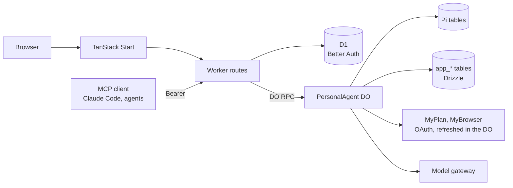

# Architecture

One Cloudflare Worker serves the web app and the API. Behind it, every user has their own `PersonalAgent` Durable
Object, named by their user ID: it runs Pi, holds that user's outbound MCP connections and credentials, and keeps
application state in its own SQLite. D1 holds Better Auth's tables only (users, sessions, inbound OAuth).

## Worker

`apps/runtime/src/worker.ts` routes every request:

| Path | What happens |
| --- | --- |
| `/health` | Stage, service name and sign-up mode. |
| `/.well-known/oauth-protected-resource*` | Protected-resource metadata for `/mcp`. |
| `/.well-known/*`, `/api/auth/*` | Better Auth: sign-up and sign-in, the OAuth authorization server for inbound clients. |
| `/mcp` | Purrable's own MCP server; a Bearer token from an inbound client reaches the agent of the user who consented. |
| `/api/*` | Owner API. A session cookie selects the signed-in user's agent; writes also need the app's own `Origin`. |

## Accounts

Anyone may sign up when `PURRABLE_SIGNUP_MODE` is `open`; with `invite` the request needs the
`PURRABLE_SIGNUP_INVITE_CODE` in an `x-invite-code` header; `closed` (the default for deployed stages) refuses every
sign-up. When the deployment sends mail, the usual way in is a six-digit code mailed to the address (ten minutes, five
tries, one per address per minute; `auth/email-code.ts`): a known address signs in, a new one gets an account through
the same sign-up gate, already verified. Passwords remain as the fallback. A signed-in user can add passkeys in
Settings (`auth/passkey.ts`, the myapps policy: Purrable's own host is the relying party, credentials are discoverable
and must verify the person; adding one needs a sign-in from the last 10 minutes) and then sign in with one without
typing an email. A passkey never creates an account, and an MCP client's authorization resumes after it like after
any sign-in. With `PURRABLE_MAIL_SENDER` set (an address on an apex onboarded for Cloudflare Email Sending), a new account
works only after its owner opens the one-hour link mailed to it (`auth/mail.ts`); the link signs them in. The same
sender carries password-reset links (`/reset-password`); a reset signs every device out, and asking for one never
reveals whether an address has an account. A deployed
stage refuses to deploy `open` sign-up without a sender. Sign-up, verification mail and sign-in are rate limited per
`cf-connecting-ip` in D1 (auth runs per request, so in-memory limits would reset every call). The agent a request
reaches is always derived from authentication, the session's user ID or the inbound token's subject, never from the
request.

Deleting an account (Settings; the password, or a sign-in within the last 10 minutes) first erases the user's agent through `Agent.destroy()`: every Pi,
Agents and application table, its alarm, and its isolate. Only then does Better Auth delete the user, and D1 cascades
their sessions, passkeys, consents and tokens. If erasing the agent fails, the account stays so the user can retry. Outbound
OAuth tokens are forgotten, not revoked at the remote server; they lapse there on their own. Users share the deployment's model key and
MCP server list; their conversations, connections, credentials, grants and resident authority are per agent.

The owner API forwards to the agent object over DO RPC. Workers RPC drops custom error classes, so every DO method
returns an encoded `RpcResult`; the Worker decodes it and maps the tagged error to a status in one place
(`http/errors.ts`, `http/respond.ts`). Failures are logged as one JSON line with route, request ID, status and
error tag, never bodies or credentials.

## The agent object

`PersonalAgent extends Agent` and registers the native `PiHarness` with the Agent lifecycle. Pi owns transcripts,
tasks, submissions, recovery and tool replay. The object builds one Effect `ManagedRuntime` lazily, providing three
services: `Mcp` (the MCP host), `Resident` (resident authority) and `Sessions` (inbound client sessions). DO methods
are thin: each runs one Effect program and encodes the exit.

Conversations: the owner's browser uses Pi's root session (the main thread). Each inbound MCP client gets its own Pi
session, created once and mapped by client ID in `app_client_sessions`.

The system prompt is two static Pi extension sections (`pi/persona.ts`): who the agent is, and that remote content
is untrusted data. The `mcp_list` and `mcp_call` tools (`pi/resident-mcp.ts`) are how the model reaches the owner's
MCP servers; both require current resident authority, and `mcp_call` is marked unsafe to replay.

`ask_user` (`pi/ask-user.ts`) is how the agent asks the owner something. It takes one to five short questions:
single choice, multiple choice or free text. The tool result is the questions as numbered plain text, with details
`{ kind: 'question', questions }` (the `QuestionSpec` contract). It ends the run with `control: { terminate: true }`,
so no model call waits on a person. The answer is the owner's next ordinary message, whether it comes from the web
card or any other channel. A question counts as settled once a later user message exists.

The browser follows the main thread over Server-Sent Events: a snapshot of committed Pi entries, then batches, with
a heartbeat. On reconnect it starts again from a fresh snapshot.

The chat view fills the screen under the header. The transcript scrolls in a `MessageScroller` (from
`@shadcn/react`). Each of the owner's turns is a scroll anchor. The view follows a streaming reply only while the
reader is at the end, and otherwise offers a jump back. The header and the composer float over the transcript as
translucent chrome. Assistant Markdown is set by shadcn/typeset, whose append-stable rules keep earlier blocks still
while a reply streams.

When the agent waits on the owner, the request is pinned above the composer until their next message
(`lib/interactions.ts`). This covers `ask_user` questions (a questionnaire) and grant-required results (an Allow card
for the exact server and tool). The reply is an ordinary message with a stable operation ID: `answer:<callId>` or
`grant:<callId>`. Allow first sets the exact grant through `PUT /api/mcp/grants`, and the allowed tool stays allowed.
In the transcript, both requests leave a quiet receipt. An Allow card is only trusted from Purrable's own result for
the tool that was called, never from a remote result, which always carries `origin`.

The composer carries the agent's presence (`lib/presence.ts`): one state for the whole agent, with the most urgent
first. In order: offline, waiting for the owner, retrying, using a tool (named `server · tool`), writing, thinking,
budget spent, no answer, and ready. A small orb of moving colour (a Paper Shaders `MeshGradient`, loaded lazily)
shows it beside a text label, and its pace follows the work. While the agent waits on the owner, a pulsing border
frames the composer. Under reduced motion, in a hidden tab or before the shader loads, the orb is a still gradient and
the border is absent. Colours come from the theme's `--presence-*` tokens, resolved to RGB at runtime.

## Outbound MCP

Servers come from `PURRABLE_MCP_SERVERS` (JSON: `serverId`, `endpoint`, optional `issuer` and `resource`) and from
the owner, who may add up to sixteen by URL (`app_mcp_servers`, ADR 0006). An added endpoint is a public https
address (`mcp/endpoint.ts`), and its server card labels it as the server's own claim. Configured servers win on ID
and cannot be removed. Removing an added server forgets everything stored for it in one transaction. Connections
also offers a shelf of suggested servers (`mcp/suggested.ts`), each checked by hand. One tap adds and connects. It also
searches MCP registries that speak the generic registry API (`mcp/registry.ts`, `GET /api/mcp/catalog?q=`): the
Official MCP Registry and GitHub's. Only the latest active entries with an https streamable-HTTP remote are shown,
labelled by registry, each server once (the official registry first), cached for ten minutes. Endpoint placeholders
are filled with one safe path segment each, and servers that want an API key are listed but cannot be added yet. An
added entry records its registry, name and version. Connect
first tries a server without sign-in, which many public servers need not have; if refused, it runs OAuth. The owner
connects each one from the Connections page:

1. `POST /api/mcp/:id/connect` runs the MCP SDK's `auth()` with our `StoredOAuthProvider`: discovery, dynamic client
   registration, PKCE. It returns the remote authorization URL; the browser goes there.
2. The remote server redirects to `/api/mcp/oauth/callback`. The pending state is single-use and expires after ten
   minutes; the code is exchanged and the tokens stored.
3. Client registration and tokens are AES-GCM encrypted at rest (`PURRABLE_CREDENTIAL_KEY`, bound to server ID and
   purpose); discovery metadata is stored in plain JSON.

Credentials and grants belong to the endpoint they were made for (`mcp/endpoints.ts`, `app_mcp_endpoints`). When the
agent starts and a server ID now points at another endpoint, everything stored for it is dropped in one short
transaction: credentials, client registration, pending authorizations and grants. The owner connects and grants
again, so tokens issued by one host never reach another.

Calls go through the `McpConnectionManager`, keyed by server ID, which caches a connection and closes it after five
minutes idle. Its auth provider refreshes a token a minute before expiry, single-flight per server, and refreshes
once after a 401. A refused refresh marks the server `needs_auth` and the owner reconnects. Results are bounded (1 MiB,
16 MiB for App HTML).

Grants are per discovered tool (`app_mcp_grants`), toggled by the owner. A tool grant also grants its `ui://` App
resource. "Allow app" (`PUT /api/mcp/app-grants`, `McpHost.setAppGrant`) grants an App as a whole: exactly the tools
that declare its `ui://` resource, including the ones only the App may call, and the resource itself. Connections
lists those tools under the switch, each still adjustable. Tool annotations from the server are shown but never grant anything. Disconnecting forgets credentials
and keeps grants. When the model calls a tool that exists but is not granted, nothing runs. `mcp_call` returns an
error result whose details are `{ kind: 'grant-required', serverId, name }`, and the model is told to wait.
`mcpModelResult` details never carry a top-level `kind`, so remote content cannot forge one. The web turns that
result into an owner-only Allow card.

## MCP Apps host

An App is a tool's `ui://` resource, served by the server that answered the call. It runs in two nested opaque
sandboxed frames (`lib/app-sandbox.ts`). The outer proxy only relays protocol messages to and from the host's origin.
Its calls go through the owner API to the originating server and need that server's grant.

The chat view has at most one live App (`components/apps`). Its iframe sits in one fixed stage that is never moved
in the DOM, because re-parenting an iframe reloads it. The stage follows the slot its display mode names, frame by
frame:

- inline: the App's place below its tool row in the transcript;
- fullscreen: a resizable side panel beside the conversation on a desktop, or a bottom sheet on a phone;
- pip: picture-in-picture, which a desktop offers and a phone does not.

When the mode changes, the stage springs from one slot to the next (`lib/spring.ts`), so the App leaves the
transcript and returns along the same path. Picture-in-picture and the sheet are dragged by the host's chrome. On
release they are thrown, by projected momentum, to the nearest corner or snap height; a sheet thrown down closes to
the transcript. On a phone, inline means the App waits behind an Open button in the transcript.

The App learns the host context (`lib/host-context.ts`): theme, our tokens as MCP Apps style variables, device,
locale, its display mode, the modes on offer, and its box. The host re-sends it when any of these change. Inline, the
App may ask for a height between 160px and 70% of the viewport. It may ask for another display mode and gets it if
the screen offers that mode.

Two more requests are drawn by the host, where the App cannot reach (`lib/app-context.ts`). A link the App asks to
open (https only, no credentials) becomes an offer with a real anchor, so only the owner's click opens it. Context
the App shares for the agent (`ui/update-model-context`, text, at most 8 KB) waits in a removable chip above the
composer and travels once, with the owner's next message, as `appContext` on `POST /api/agent`. The runtime
(`pi/app-context.ts`) appends it after the owner's words as a separate block shaped
`{ origin: { serverId, trust: 'untrusted' }, appContext }`. The persona treats it as data, never as the owner
speaking, and the transcript shows it as a note under their message.

An App's own call to a tool the owner has not granted does not fail at once (`components/apps/grant-ask.tsx`). It
waits on a card the host draws in the App's chrome, naming the exact tool. Allow grants that one tool and runs the
same call again. "Not now", or two minutes without an answer, returns the denial to the App.

## Models

Each user picks the model their agent answers with, in the composer. The deployment offers `PURRABLE_MODEL_ID` (the
default) plus `PURRABLE_MODELS`, all served by the same LiteLLM key; `models.ts` names and groups them by route
(Google, Alibaba Cloud), because quota runs out per route. The pick is one row in `app_model_choice`; without one, or
when the deployment stops offering it, the default applies. Pi stores one model per conversation, set when it is
created, so before each turn the agent calls `session.setModel` for the session the turn runs in (the main thread or
an inbound client's), skipping it when that session already has the model. Every offered model is registered with
Pi's `Models` under the one `purrable-litellm` provider. A failed model call shows its reason in the chat, and a
quota or outage failure points at the picker.

## Model budget

Users share the deployment's model key, so each agent has a daily token budget (`PURRABLE_MODEL_DAILY_TOKENS`,
default 300 000, per UTC day). A Pi extension (`pi/budget.ts`) records every model response's tokens in
`app_usage_daily`. Once the day is spent, new turns are refused with `BudgetExhausted` (429), from the browser and
from `/mcp`, and tool calls inside a running turn are blocked, so a looping turn ends after one more reply. Pi
reports and swallows exceptions thrown by hooks, so the in-turn lever is blocking tools, not throwing. Settings shows
today's usage, and the composer shows it as a ring, re-read whenever a run ends. On wider screens the composer also
shows how full the context was at the latest response, measured against the model's `contextWindow`. The model key's
own cap stays the backstop.

## Resident authority

The agent acts for the owner when the owner is not there, so it needs its own standing permission rather than a
borrowed browser session. `ResidentAuthority` (`app_resident`) is active for 30 days and every owner API call renews
it. Revoking it in Settings sticks: activity does not re-enable it, only the explicit toggle does. Every outbound MCP
call, from the owner API or the model, checks it.

## Inbound MCP

Purrable is an MCP server at `/mcp`, the protected resource of Better Auth's `mcp()` authorization server:

- Clients register dynamically (open, but restricted to the `/mcp` resource). A registration whose redirects are
  all http loopback is marked native, which is how Claude Code registers.
- The owner signs in and consents at `/consent`. A Bearer token is accepted only if it verifies against the local
  JWKS, names `/mcp` as audience, comes from an enabled client and the owner's consent still exists.
- Tools: `ask_agent` (submit to the client's own session and wait up to 110 seconds; a stable `operationId` makes it
  idempotent) and `get_recent_messages` (the client's own session only).
- Revoking a client in Settings deletes the consent, disables the client and revokes its refresh tokens; its next
  call gets a 401.

## Storage

| Store | Tables | Owner |
| --- | --- | --- |
| Agent DO SQLite | `pi_*`, `cf_agents_*` and the other vendor tables | Pi, Agents SDK. Never touched. |
| Agent DO SQLite | `app_mcp_credentials`, `app_mcp_oauth_pending`, `app_mcp_grants`, `app_resident`, `app_client_sessions`, `app_usage_daily`, `app_metadata` | Drizzle, inline migrations in `storage/migrations.ts` |
| D1 `PurrableAuth` | `user`, `session`, `jwks`, `oauth*` | Better Auth, `apps/runtime/migrations` |

Better Auth lives in D1 because the Durable SQLite adapter's async transactions and affected-row semantics do not
meet its contract (ADR 0001). SQLite transactions are short and never span model or network calls.

## Infrastructure

`apps/web/alchemy.run.ts` declares the Vite Worker, the `PersonalAgent` namespace and the D1 database; it is the only
deployment entrypoint. The local stage runs in workerd with CLIProxy; the dev stage calls Railway LiteLLM with a
dedicated key limited to the offered models (Gemini 3.8 Flash and four Alibaba Token Plan models) and $10 per 30 days.
The Token Plan's weekly quota is shared with Hermes and the coding agents, and LiteLLM may not price those models, so
the per-user daily budget is their real limit. Secrets are Worker secret bindings, never in the browser
bundle.
